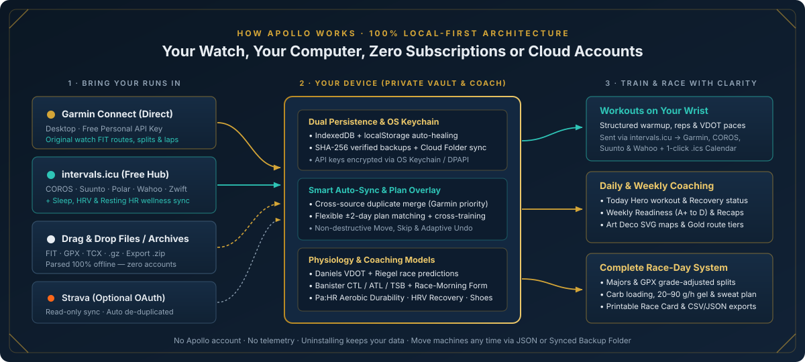
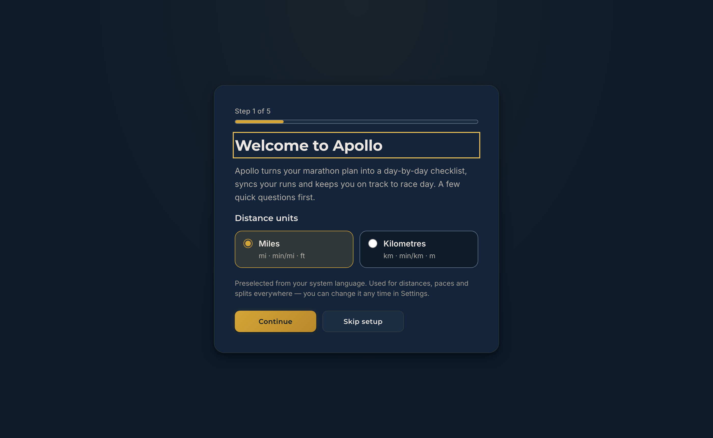
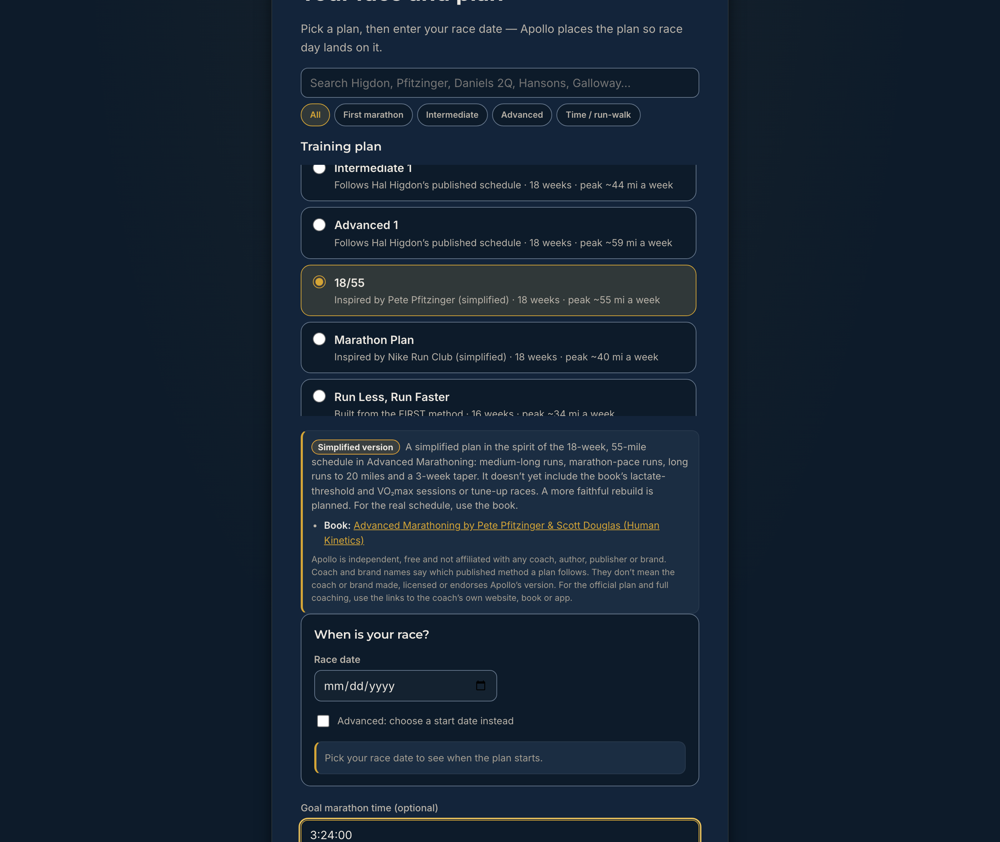
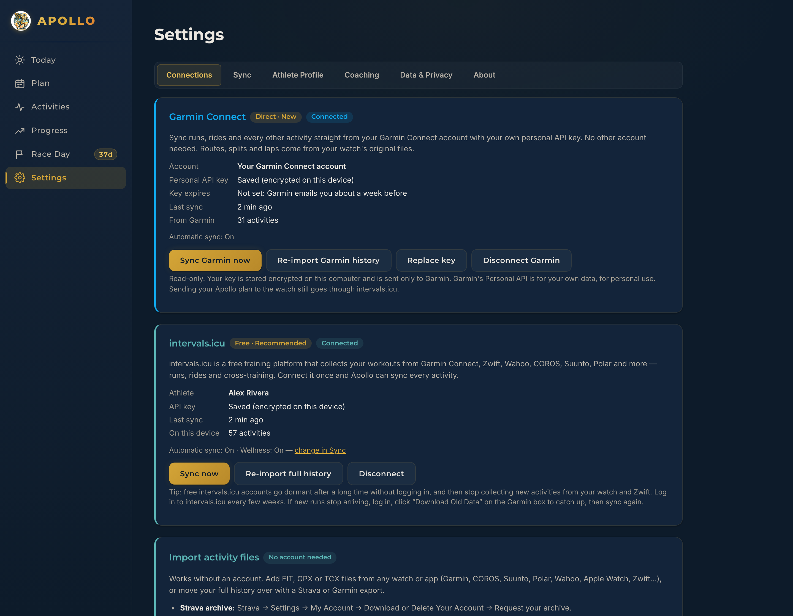
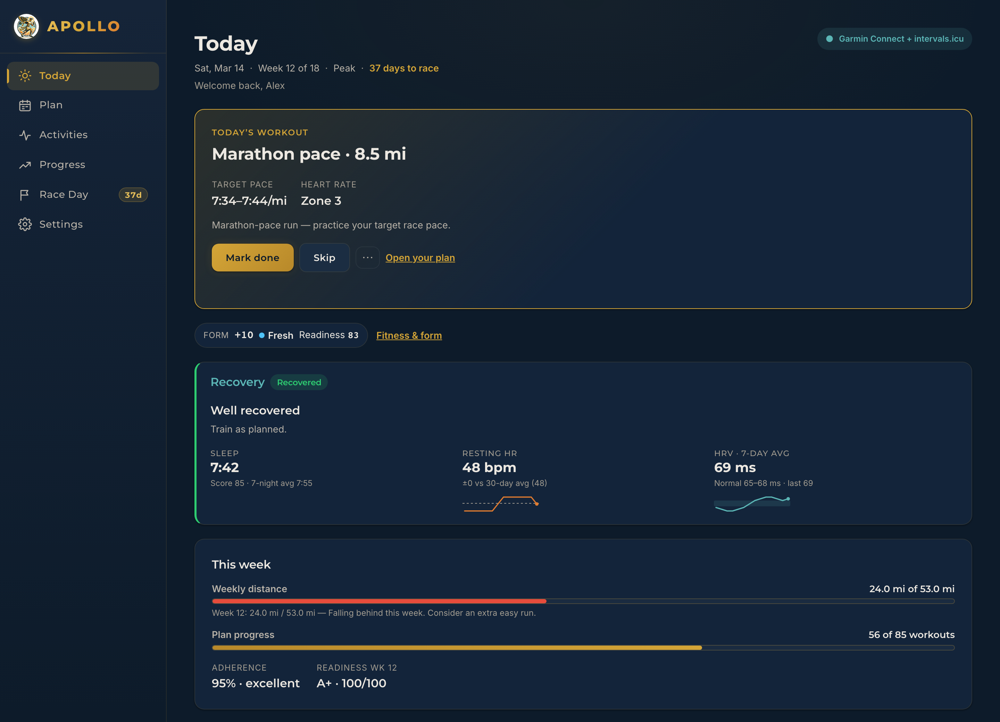
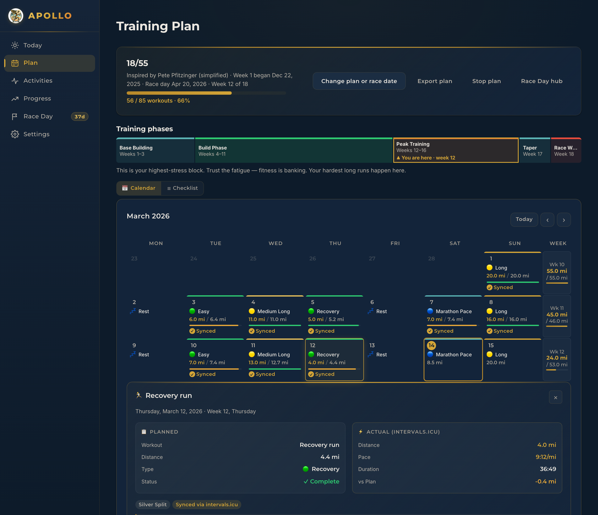
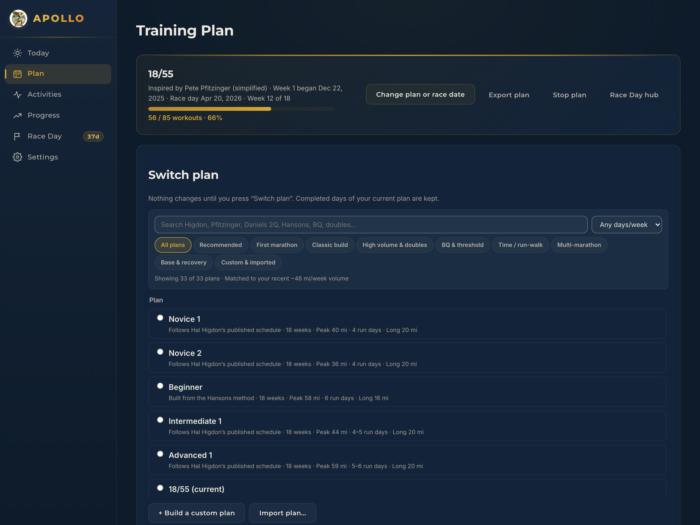
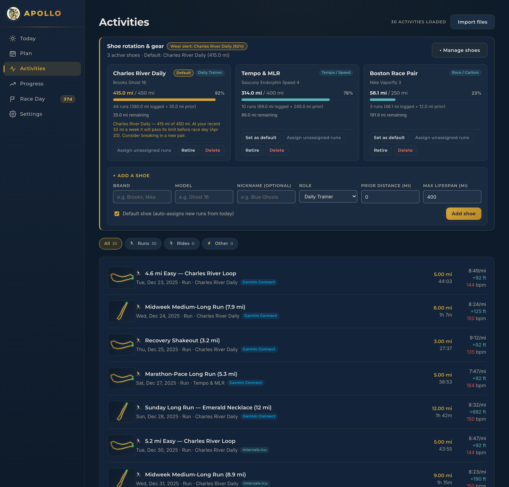
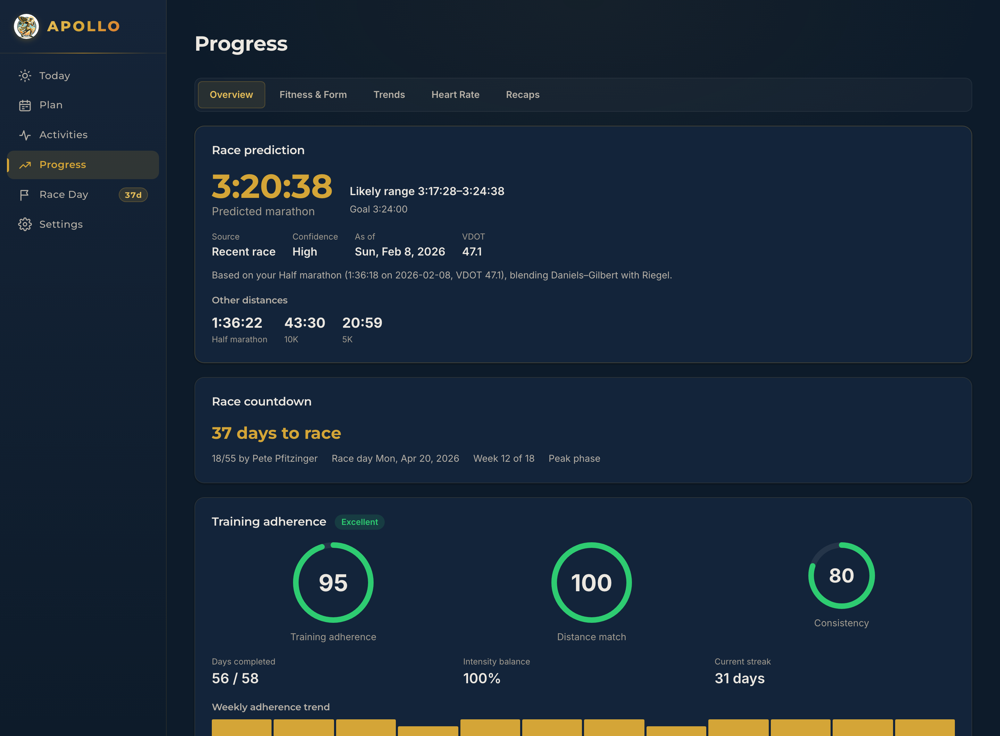
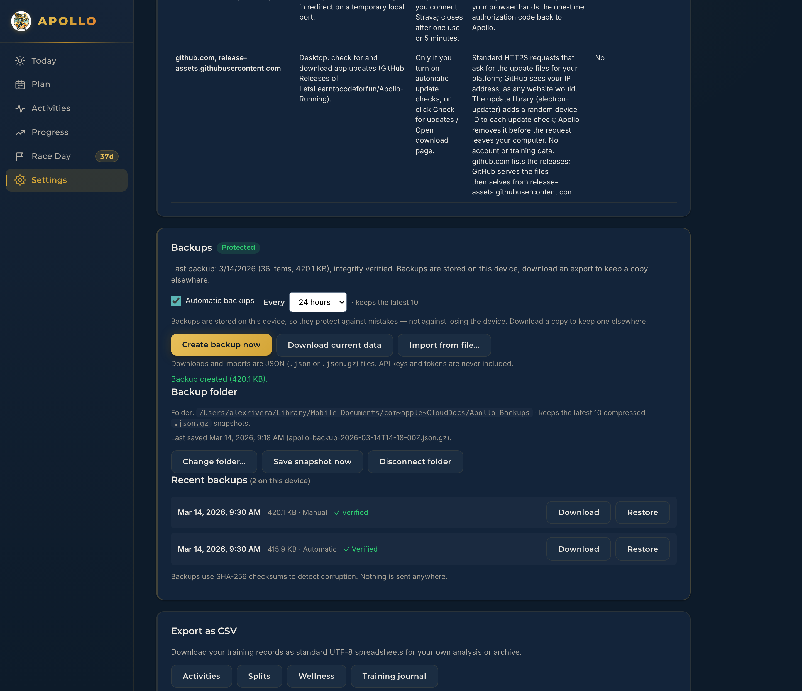

# Apollo Quick-Start Guide

Welcome to **Apollo** — a calm, local-first marathon training platform built for runners who want serious coaching tools without subscriptions, cloud accounts, or data harvesting.

Everything in Apollo lives on your own device: your training schedule, synced watch files, GPS routes, heart-rate history, wellness trends, shoe rotation, and race-day fueling plan. Whether you are training for your first 26.2 or chasing a Boston Qualifier, this guide walks you from installation through your first full week of training in about ten minutes.

> **Looking for the coaching manual?** Once you finish setting up Apollo, read the **[Training Program Guide](TRAINING_PROGRAM_GUIDE.md)** for an in-depth playbook on selecting among all 33 built-in plans, calibrating heart-rate and VDOT zones, reading Banister Fitness & Form (`CTL`/`ATL`/`TSB`) and Aerobic Durability (`Pa:HR`), adapting weeks safely, and executing race week and race morning as a complete system.

---

## Table of Contents

1. [How Apollo Works: Local-First by Design](#1-how-apollo-works-local-first-by-design)
2. [Desktop App vs. Browser Version](#2-desktop-app-vs-browser-version)
3. [Install & Open Apollo](#3-install--open-apollo)
4. [First-Run Onboarding (5 Steps)](#4-first-run-onboarding-5-steps)
5. [Connect Your Watch & Import Your Runs](#5-connect-your-watch--import-your-runs)
   - [Option A: Garmin Connect Direct (Desktop App)](#option-a-garmin-connect-direct-desktop-app)
   - [Option B: intervals.icu (Free — Desktop & Browser)](#option-b-intervalsicu-free--desktop--browser)
   - [Option C: Offline File & Archive Import (No Account Needed)](#option-c-offline-file--archive-import-no-account-needed)
   - [Option D: Strava (Optional — Desktop App)](#option-d-strava-optional--desktop-app)
6. [Guided Tour: Apollo Page by Page](#6-guided-tour-apollo-page-by-page)
   - [Today — Your Daily Briefing](#today--your-daily-briefing)
   - [Plan — Your Training Calendar & Phase Ribbon](#plan--your-training-calendar--phase-ribbon)
   - [Activities — Routes, Splits, Journal & Shoe Garage](#activities--routes-splits-journal--shoe-garage)
   - [Progress — Readiness, Fitness & Form, and Aerobic Durability](#progress--readiness-fitness--form-and-aerobic-durability)
   - [Race Day — Pacing, Fueling, Checklist & Morning Timeline](#race-day--pacing-fueling-checklist--morning-timeline)
   - [Settings — Profile, Coaching & Verified Backups](#settings--profile-coaching--verified-backups)
7. [Your First 7 Days with Apollo](#7-your-first-7-days-with-apollo)
8. [Troubleshooting & Common Questions](#8-troubleshooting--common-questions)

---

## 1. How Apollo Works: Local-First by Design

Most training platforms upload your GPS tracks, sleep records, and heart-rate data to a company server before showing them back to you. Apollo reverses that architecture: **your computer is the database**.

- **No Apollo account or server** — Apollo has no sign-up screen, no telemetry, and no cloud backend.
- **Encrypted credentials** — When you connect Garmin Connect, `intervals.icu`, or Strava in the desktop app, your API keys and tokens are encrypted through your operating system's native keychain (`safeStorage`: macOS Keychain, Windows DPAPI, or Linux Secret Service / KWallet) and sent only to the service you connected.
- **Verified local storage** — Apollo saves your data in the app's own IndexedDB database (`ApolloRunning`) and keeps a second copy of everything small enough in local storage, so either copy can restore the other. Rolling backups are stored in IndexedDB too, each with a SHA-256 checksum that's checked after it's written. If a disk write ever fails, Apollo shows an immediate **Not saved** banner with a **Retry** button rather than failing silently.
- **Training guidance, not medical advice** — Every physiological formula in Apollo (Daniels VDOT, Riegel race equivalencies, Banister `CTL`/`ATL`/`TSB`, Minetti grade-adjusted Efficiency Factor, Plews rolling HRV, Burke carbohydrate loading, and Jeukendrup in-race fueling) cites its published sports-science source and states its assumptions plainly.

---

## 2. Desktop App vs. Browser Version

Apollo runs natively on **macOS, Windows, and Linux**, and also runs directly in a modern web browser with nothing to install. Both share the exact same coaching engine, 33 training plans, analytics charts, and race-day tools.

| Capability | Desktop App (macOS · Windows · Linux) | Browser Version (Web) |
|---|---|---|
| **33 built-in plans + Custom Plan Builder** | Yes | Yes |
| **Offline FIT / GPX / TCX / `.gz` / `.zip` archive import** | Yes | Yes |
| **`intervals.icu` activity sync, wellness & watch workouts** | Yes | Yes |
| **Direct Garmin Connect Personal API sync** | **Yes** | Desktop only *(Garmin's API blocks browser requests)* |
| **Strava OAuth sync** | **Yes** | Desktop only |
| **OS Keychain credential encryption** | **Yes** | Stored in browser storage for that profile |
| **Automatic synced `.json.gz` Backup Folder** | **Yes** *(iCloud, Dropbox, OneDrive, external drive)* | Manual `.json` download & restore |
| **Data persistence** | Dedicated app folder in your OS user profile | Scoped to that specific browser and device |

> **Switching later is effortless.** You can start in your browser today, click **Settings › Data & Privacy › Download current data**, install the desktop app later, and click **Import from file…** to bring everything across in seconds.

---

## 3. Install & Open Apollo

1. Download the installer for your computer from the **[latest release](https://github.com/LetsLearntocodeforfun/Apollo-Running/releases/latest)**:
   - **Windows 10/11:** `Apollo-Setup-<version>.exe`
   - **Mac (Apple Silicon M1/M2/M3/M4+):** `Apollo-<version>-arm64.dmg`
   - **Mac (Intel):** `Apollo-<version>-Intel.dmg` / `Apollo-<version>.dmg`
   - **Linux:** `Apollo-<version>.AppImage` (any distribution) or `apollo-marathon_<version>_amd64.deb` (Debian / Ubuntu)
   - **Browser (zero install):** Open **[letslearntocodeforfun.github.io/Apollo-Running](https://letslearntocodeforfun.github.io/Apollo-Running/)**
2. Because Apollo is free open-source software without a paid publisher signing certificate yet, your operating system asks you to confirm once on the very first launch:
   - **Windows:** Click **More info** → **Run anyway**.
   - **macOS 15 Sequoia and later:** Open Apollo once, click **Done**, then open **System Settings → Privacy & Security**, scroll down, and click **Open Anyway**.
   - **macOS 14 Sonoma and earlier:** **Control-click** Apollo in **Applications** → **Open** → **Open**.
   - **Linux AppImage:** Run `chmod +x Apollo-<version>.AppImage && ./Apollo-<version>.AppImage`.

For SHA-256 checksum verification, Sigstore build provenance checks, and platform-specific tips, see the **[Step-by-Step Install Guide](INSTALL.md)** and **[Code Signing Notes](SIGNING.md)**.

---

## 4. First-Run Onboarding (5 Steps)

The first time Apollo opens, a five-step setup flow gets your units, marathon schedule, and training paces configured cleanly. Nothing you pick here is permanent — you can change every setting later.

### Step 1 of 5 — Welcome to Apollo (Units)

Apollo preselects **Miles** (`min/mi · ft`) or **Kilometres** (`min/km · m`) based on your system language and region. Pick whichever unit system you think in on the road and click **Continue**.

### Step 2 of 5 — Your Race and Plan

Here you choose your marathon structure and anchor it to your race calendar:

1. **Filter or search the library** — Use the search box (`Search Higdon, Pfitzinger, Daniels 2Q, Hansons, Galloway…`) or filter pills (**All**, **First marathon**, **Intermediate**, **Advanced**, **Time / run-walk**) to browse Apollo's **29 built-in marathon plans** — or select **Build my own plan** to generate a custom schedule tailored to your exact run days and mileage. *(Four additional base-building and post-race recovery blocks are available anytime from the **Plan** page.)*
2. **Check the coach attribution & fidelity note** — Selecting any built-in plan reveals a plain-English note explaining how closely the schedule follows the coach's published work (*Follows the published schedule*, *Built from the published method*, or *Simplified version*) with a link to the official book or site. Plans Apollo wrote itself say *Designed by Apollo*.
3. **Enter your race date (`When is your race?`)** — Apollo works **backward from race day** so your final marathon Sunday (or Monday for Boston!) lands squarely on race day.
   - *Joining mid-block?* If your race is closer than the plan's full length (for example, 12 weeks out on an 18-week plan), Apollo automatically calculates which week you would join, compares that week's volume and long run against your recent running, and warns you if the jump is steep — offering a gentler plan or custom length if needed.
4. **Set an optional Goal marathon time (`H:MM:SS`)** — Used for goal-pace workouts and your initial Race Day strategy.

### Step 3 of 5 — A Recent Race (Optional)

If you have run an all-out **5K**, **10K**, **Half marathon**, or **Marathon** recently, enter the distance, finish time, and date. Apollo uses Jack Daniels' VDOT tables (blended with Riegel's endurance curve) to calibrate your **Easy**, **Marathon**, **Threshold (Tempo)**, **Interval**, and **Repetition** paces from day one. If you haven't raced recently, click **Skip this step** — Apollo can estimate predictions later once you log runs or races, or pace from your goal marathon time.

### Step 4 of 5 — Connect Your Training Data

Choose how you want runs to reach Apollo:

- **Connect intervals.icu or Strava** — Opens **Settings › Connections** as soon as you finish onboarding (this is also where desktop users connect **Garmin Connect** directly).
- **Import files** — Opens the drag-and-drop importer right inside setup so you can drop `.fit`, `.gpx`, `.tcx`, or a full Garmin/Strava export `.zip` immediately.
- **Not now** — Takes you straight to the app so you can explore first and connect whenever you are ready.

### Step 5 of 5 — You're All Set

Review your summary card (Units, Plan, Week 1 start date, Race day, Goal time, Recent race, and Data source) and click **Go to Today** (or **Finish and open Connections**).

---

## 5. Connect Your Watch & Import Your Runs

Open **Settings › Connections** at any time to link a watch platform or drop in files. You can use one source or combine several — Apollo automatically deduplicates overlapping workouts so you never get double-counted mileage.

### Option A: Garmin Connect Direct (Desktop App)

Garmin allows every Garmin Connect user to generate a free **Personal API Key** for their own data. In the Apollo desktop app, this connects straight to Garmin with no middleman account required:

1. Sign in to Garmin Connect on the web and open **Settings › Personal API Key** (linked directly inside Apollo's Garmin card).
2. Click **Create Key**, accept Garmin's personal-use terms, and choose an expiration window (30 days up to 1 year).
3. Copy the key immediately (Garmin displays it only once) and paste it into **Settings › Connections › Garmin Connect** under **Personal API key**.
4. Select the **Expiration you chose** so Apollo can remind you 7 days before it expires, leave **Sync automatically when Apollo opens and while it runs** checked if you want hands-free syncing, and click **Connect Garmin & import history**.

**What comes across:** Every run, ride, swim, and cross-training workout, complete with GPS routes, per-mile/km splits, manual laps, and best efforts extracted from your watch's original FIT files. When a key eventually expires, click **Replace key** — your history and sync progress stay intact.

### Option B: intervals.icu (Free — Desktop & Browser)

**[intervals.icu](https://intervals.icu)** is a respected, free-to-use training hub that connects natively with **COROS, Suunto, Polar, Wahoo, Garmin, Zwift**, and Apple Watch (via HealthFit or RunGap). Even if you already sync activities directly from Garmin Connect, connecting `intervals.icu` unlocks two extra superpowers in Apollo: **overnight wellness sync** and **pushing structured workouts to your watch**.

1. Create a free account at [intervals.icu](https://intervals.icu) and link your watch brand in `intervals.icu` **Settings**.
2. Scroll down to **Developer Settings** in `intervals.icu`, generate your **API Key**, and copy your **Athlete ID** (for example, `i123456`).
3. In Apollo, open **Settings › Connections › intervals.icu**, paste your API key (Athlete ID is optional — Apollo can detect it automatically), choose whether to turn on automatic activity sync and **Wellness data** (`sleep, HRV and resting HR`), and click **Connect & import history**.

> **Two helpful `intervals.icu` habits:**
> - **Set your Run Threshold Pace in `intervals.icu` (`Settings › Run`)** if you plan to push Apollo workouts to a Garmin watch. Without a threshold pace on file in `intervals.icu`, Garmin watches display *"No Target"* on pace-based steps. Apollo checks this automatically and lets you know if it's missing.
> - **Log into `intervals.icu` on the web every few weeks.** Free `intervals.icu` accounts pause background collection from watch vendors after extended inactivity; logging in wakes them right back up.

### Option C: Offline File & Archive Import (No Account Needed)

Prefer 100% air-gapped training with zero online accounts?

1. Go to **Settings › Connections › Import files** (or use the importer on the **Activities** page).
2. Drag and drop individual `.fit`, `.gpx`, `.tcx` (including `.gz` compressed files), or drop an entire **Garmin Account Export `.zip`** or **Strava Bulk Export `.zip`**.
3. Apollo parses GPS tracks, elevation, heart rate, cadence, laps, and splits locally in a single batch and matches runs to your training plan automatically.

### Option D: Strava (Optional — Desktop App)

If you have a personal Strava API application (`Client ID` and `Client Secret` from [strava.com/settings/api](https://www.strava.com/settings/api)), expand the **Strava** card in **Settings › Connections** in the desktop app to authorize read-only OAuth sync. Strava is completely optional and never required.

---

## 6. Guided Tour: Apollo Page by Page

Apollo's left navigation bar has six clean destinations. Here is what each one does and how you will use it week to week.

### Today — Your Daily Briefing

**Today** answers one question the moment you open the app: *"What is on the schedule today, and how ready is my body to run it?"*

- **Today's Workout card** — Displays today's planned session, distance, VDOT/goal-calibrated **Target Pace**, and **Heart Rate** zone. Click **Mark done** to check it off manually, **Skip** if life gets in the way, or the **`…` menu** to move it to another day or convert it to an easy run. Once a run syncs for today, this card automatically updates to show your completed run alongside the plan.
- **Form & Readiness strip** — Shows your live Banister **Form (`TSB`)** badge (for example, `+10 · Fresh`) and latest **Readiness** score with a one-click jump to **Fitness & form**.
- **Recovery card** *(when wellness sync is enabled)* — Compares last night's **Sleep**, **Resting HR** (vs. your 30-day average), and **7-day rolling HRV** (vs. your 60-day normal range) to give a calm, conservative daily signal: **Recovered**, **OK**, or **Caution**.
- **This week** — Tracks weekly distance against your plan target, overall workout completion, plan adherence percentage, and your current week's **Readiness** letter grade (`A+` through `D`).

### Plan — Your Training Calendar & Phase Ribbon

**Plan** gives you both a bird's-eye view of your entire marathon build and granular control over every day.

- **Plan header & actions** — Shows your active plan, start date, race date, current week, and completion bar. From here you can click **Change plan or race date**, **Export plan** (to push workouts to `intervals.icu` / your watch, export an `.ics` calendar for Apple/Google/Outlook, or save a portable `.apollo-plan.json` (`apollo.training-plan.v1`) file), **Stop plan**, or jump to the **Race Day hub**.
- **Training phases ribbon** — Automatically maps your block into **Base Building → Build Phase → Peak Training → Taper → Race Week**, highlighting `▲ You are here` with coaching guidance tailored to that phase.
- **Calendar ↔ Checklist views** — Use **Calendar** for a visual monthly grid with intensity color bars, `✓ Synced` badges, and weekly mileage totals down the right-hand column, or toggle to **Checklist** for a classic week-by-week accordion.
- **Click any day to inspect or edit** — Selecting a day opens the detail drawer comparing **Planned** vs. **Actual** distance, pace, duration, and delta, plus options to move, skip, convert, or restore the original workout without ever mutating the underlying coach template.

Want to explore other plans, start an 8- or 12-week base block before your marathon build, or run a 4-week post-race reverse taper? Click **Change plan or race date** to open the full 33-plan library and custom builder. Base and recovery blocks have no race day: you choose when Week 1 starts, and your own race date on **Race Day** stays in charge. **Import plan…** and **Export plan** move a plan between devices as an `.apollo-plan.json` file; an imported plan is always saved as a new plan and marked *Imported plan* (not verified by Apollo). The plan you're following can't be removed; removing another one also removes its progress, and Apollo tells you exactly what first. **Export plan** saves the plan itself, without your moves and skips.

### Activities — Routes, Splits, Journal & Shoe Garage

**Activities** is your searchable training log across running and cross-training, paired with gear tracking so race day never catches you in dead foam.

- **Shoe rotation & gear** — Click **Manage shoes** to add your trainers and carbon race shoes, assign roles (**Daily Trainer**, **Long Run**, **Tempo / Speed**, **Race / Carbon**, **Recovery**, **Trail**), set a default shoe for new runs, and track cumulative mileage against each pair's retirement limit (default `400 mi` / `650 km`). Based on your recent weekly volume, Apollo even warns you if a pair is projected to wear out before marathon day.
- **Expand any run for deep analysis** — Click an activity row to view its offline **Art Deco SVG route map**, mile/km **split pacing chart** and split-consistency grade, **Route Effort Recognition** (`Gold` / `Silver` / `Bronze` badges comparing repeated neighborhood loops), heart-rate zone breakdown, and your **Training Journal** (RPE effort slider, feel tags, and personal notes).

### Progress — Readiness, Fitness & Form, and Aerobic Durability

**Progress** organizes your physiological trends into five focused sub-tabs (**Overview**, **Fitness & Form**, **Trends**, **Heart Rate**, and **Recaps**):

- **Overview** — Displays your blended **Daniels VDOT + Riegel Race Predictions** (`5K`, `10K`, `Half`, `Marathon`) with confidence badges, your 5-factor **Weekly Readiness** score, and **Adaptive Coaching** suggestions you can apply or undo in one click.
- **Fitness & Form** — Plots your 42-day **Fitness (`CTL`)**, 7-day **Fatigue (`ATL`)**, and **Form (`TSB`)**, plus a dashed forward projection of your **planned race-morning form** right into the `+15 to +25` peak readiness window.
- **Trends** — Tracks multi-week mileage, pace progression, long-run build, and consistency streaks.
- **Heart Rate** — Shows your 5-zone distribution (clearly labeling whether time-in-zone is measured from streams or estimated from average HR) and **Aerobic Durability (`Pa:HR & Efficiency Factor`)**, verifying whether your heart rate stays coupled (`≤ 5%` drift) across long steady runs.
- **Recaps** — Archives your daily workout grades and weekly readiness check-ins.

### Race Day — Pacing, Fueling, Checklist & Morning Timeline

Notice the countdown badge next to **Race Day** in the sidebar (`37d`). Everything needed for marathon execution lives under five sub-tabs:

- **Strategy** — Pick one of the **6 built-in World Marathon Majors** (Tokyo, Boston, London, Berlin, Chicago, New York City), browse custom races, or click **Import a race** to upload **any marathon's `.gpx` course file** for automatic grade-adjusted mile-by-mile pacing (*Negative split*, *Even split*, *Effort-based*, or *Positive split*).
- **Fuel** — Build a 36–48h **Carb-Loading Plan** (`8–12 g/kg/day`), set your gut-trained in-race **Carb Target** (`20–90 g/h` with automatic aid-station gel timing), log a **Sweat-Rate Test** to calibrate fluid (`≤ 800 mL/h` planned ceiling) and sodium guidance, and optionally add pre-race caffeine (`~3 mg/kg`).
- **Race Week** — Work through a customizable **50-item Race Week Checklist** (Gear, Nutrition, Logistics, Race Morning, Mental Prep, Post-Race) and generate a **Printable Race Card** with 5K checkpoint splits, pace band, emergency contact, and mile-marker mantras.
- **Race Morning** — Enter your gun/wave start time to generate a backward-timed schedule from wake-up alarm and pre-race breakfast (`~2 g/kg`, 3 hours pre-gun) to gear check and corral close.
- **Course** — Study course-specific hills, surface notes, and training simulations for your target race.

### Settings — Profile, Coaching & Verified Backups

**Settings** keeps configuration transparent and organized across six tabs:

1. **Connections** — Garmin Connect (desktop), `intervals.icu`, offline FIT/GPX/TCX/ZIP file import, and Strava (desktop).
2. **Sync** — Toggle automatic launch/background sync (`Every 30 minutes`, `Every hour`, etc.) and opt-in `intervals.icu` wellness sync.
3. **Athlete Profile** — Switch units (`Miles`/`Kilometres`, `°F`/`°C`, `kg`/`lb`) with instant effect, set Max HR, Resting HR, body weight, recent race, goal marathon time, and fueling defaults.
4. **Coaching** — Schedule your Daily Training Recap time, choose your Weekly Readiness check-in day, and tune Adaptive Training sensitivity (*Conservative*, *Balanced*, or *Aggressive*).
5. **Data & Privacy** — Inspect exact local storage usage, see every network service Apollo is allowed to contact, manage rolling **SHA-256 verified backups**, link a desktop **Backup folder** (such as iCloud Drive, Dropbox, OneDrive, or a USB drive) for automatic `.json.gz` snapshots, or **Export as CSV** (`Activities`, `Splits`, `Wellness`, `Training journal`).
6. **About** — Version info, update checks, changelog, and open-source license details.

---

## 7. Your First 7 Days with Apollo

Use this simple checklist during your first week so every piece of Apollo is working smoothly for you:

- [ ] **Day 1 — Complete onboarding & protect your data:** Pick your plan and race date, connect Garmin Connect or `intervals.icu` (or drop in your past watch files), then visit **Settings › Data & Privacy** and click **Create backup now** (and **Choose folder…** if you are on the desktop app).
- [ ] **Day 2 — Dial in your Athlete Profile:** Open **Settings › Athlete Profile** and confirm your **Max heart rate**, **Resting heart rate**, **Body weight** (used later for carb-loading and caffeine math), and either a **Recent race** or **Goal marathon time**.
- [ ] **Day 3 — Add your running shoes:** Open **Activities → Manage shoes**, enter your primary daily trainer and long-run/race shoes with their current mileage, and mark your main pair as **Default** so new runs log to it automatically.
- [ ] **Day 4 — Push workouts to your watch (optional):** If you use `intervals.icu`, click **Export plan** on the **Plan** page to sync VDOT-paced structured workouts to your watch calendar, and verify your Run Threshold Pace is set in `intervals.icu › Settings › Run`.
- [ ] **Day 5 — Practice a flexible schedule edit:** Life rarely follows an 18-week grid without a hiccup. Click an upcoming run on the **Plan** calendar and test moving it to an adjacent rest day (you can click **Restore original** right afterward).
- [ ] **Day 6 — Log a post-run journal note:** After your weekend long run syncs, expand it on **Activities**, inspect your splits and route map, and jot down a quick RPE score and fueling note in the **Training Journal** — this builds your personal gut-training record for race day.
- [ ] **Day 7 — Review your first Weekly Readiness score:** Open **Today** or **Progress › Overview** to read your five-factor **Readiness** check-in and preview next week's key workouts.

---

## 8. Troubleshooting & Common Questions

### My synced run didn't check off today's planned workout automatically. Why?
Apollo's smart auto-sync matches runs within a **±2-day window** when the distance and workout type align reasonably with the plan, so an easy Tuesday shakeout won't accidentally check off a 20-mile Sunday long run. You can always open the day on **Today** or **Plan** and click **Mark done**, or move the planned workout onto the day you ran it.

### My Garmin watch shows "No Target" on workouts pushed through `intervals.icu`.
Garmin requires a **Run Threshold Pace** in `intervals.icu` to translate percentage-based pace targets onto the watch. Open `intervals.icu` → **Settings** → **Run**, enter your threshold pace, and re-sync your plan from Apollo's **Plan › Export plan** menu.

### New runs stopped arriving from `intervals.icu`.
Free `intervals.icu` accounts pause automatic device polling if you haven't signed in to their website in several weeks. Sign in at [intervals.icu](https://intervals.icu), click **Download Old Data** on your watch box if needed, then click **Sync now** in **Settings › Connections**.

### Garmin Connect shows a "Reconnect needed" or expiring-key notice.
Garmin Personal API keys have a fixed lifespan (30 days to 1 year, chosen when you created the key). Generate a fresh key in Garmin Connect web (`Settings › Personal API Key`) and click **Replace key** in **Settings › Connections › Garmin Connect**. Your stored runs, routes, and sync history remain untouched.

### How do I move Apollo to a new computer, or move from the Browser version to the Desktop app?
On your current setup, open **Settings › Data & Privacy** and click **Download current data** to save a `.json` snapshot (API keys are intentionally excluded for security). On your new computer or desktop install, open **Settings › Data & Privacy → Import from file…**, select that file, and reconnect your watch service if desired.

### Where should I go next to learn how to structure my training block?
Continue to the **[Apollo Training Program Guide](TRAINING_PROGRAM_GUIDE.md)** — our complete manual on macrocycle structure, choosing among all 33 plans, heart-rate and VDOT calibration, reading `CTL`/`ATL`/`TSB` and `Pa:HR` durability, adapting to fatigue or missed days, and executing your marathon taper, fueling, and race-day pacing strategy.
