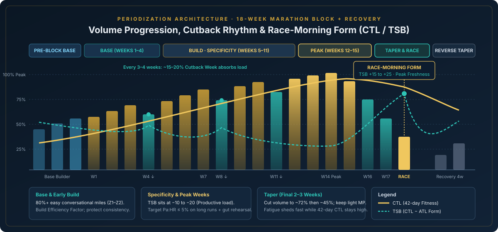
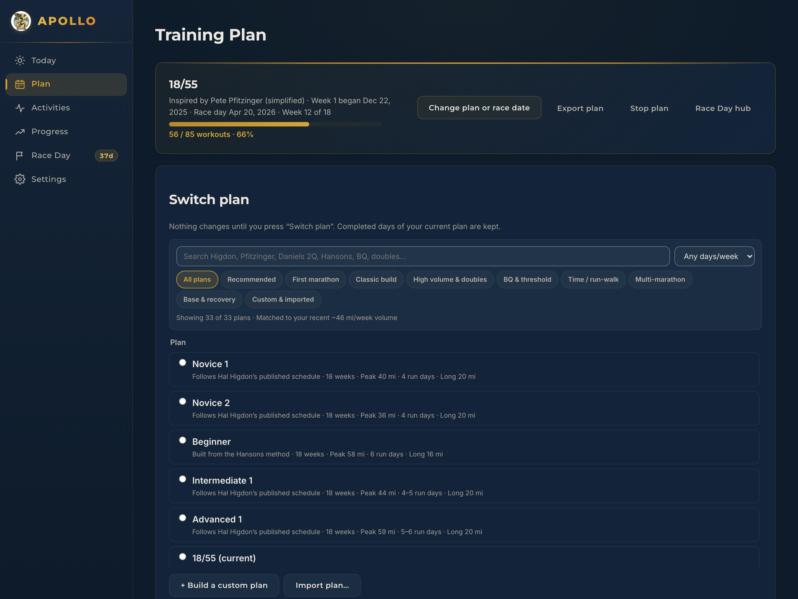
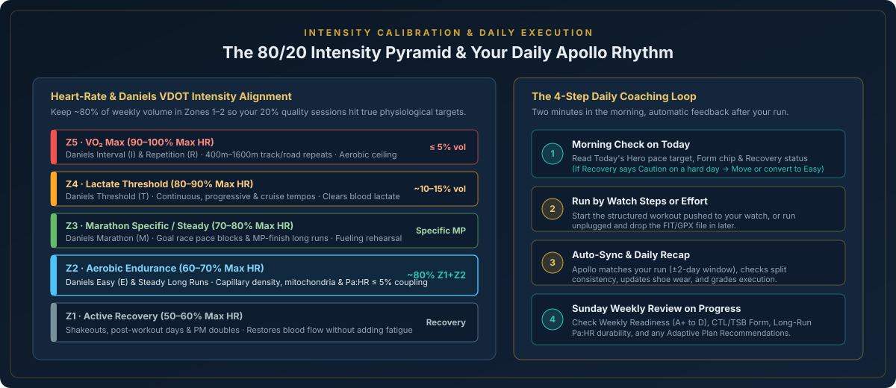
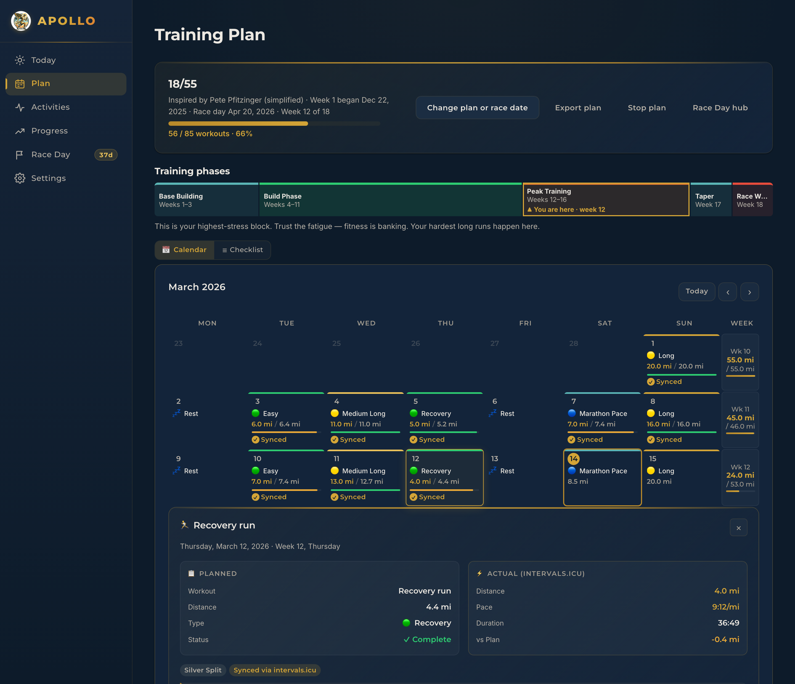
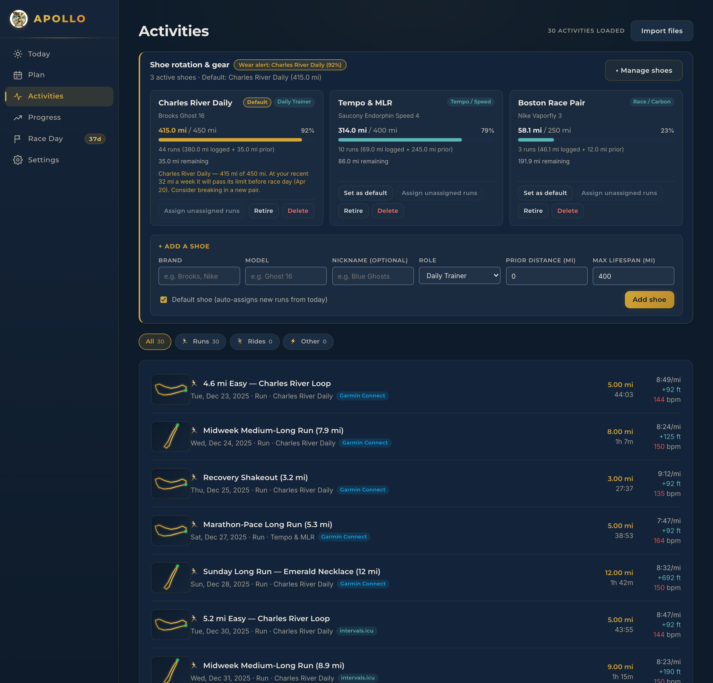
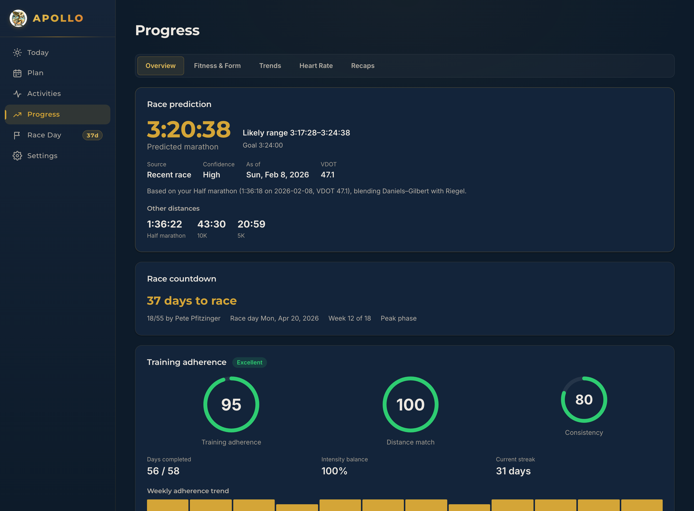
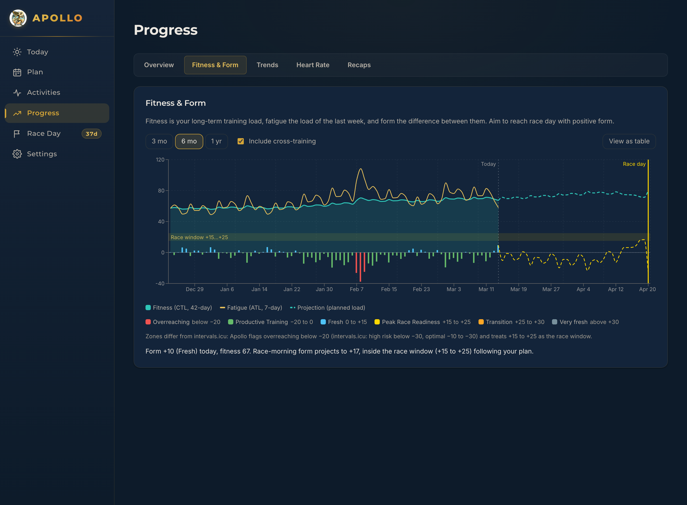
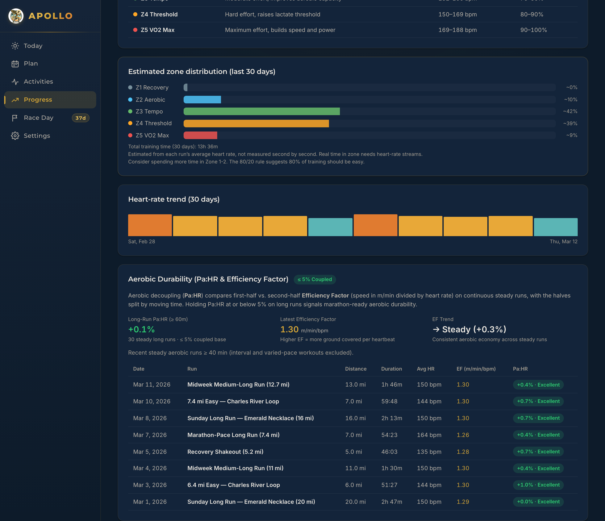
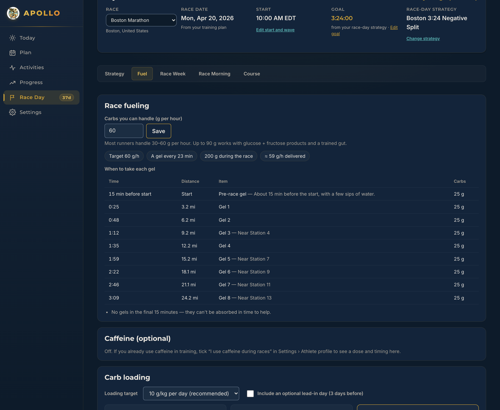
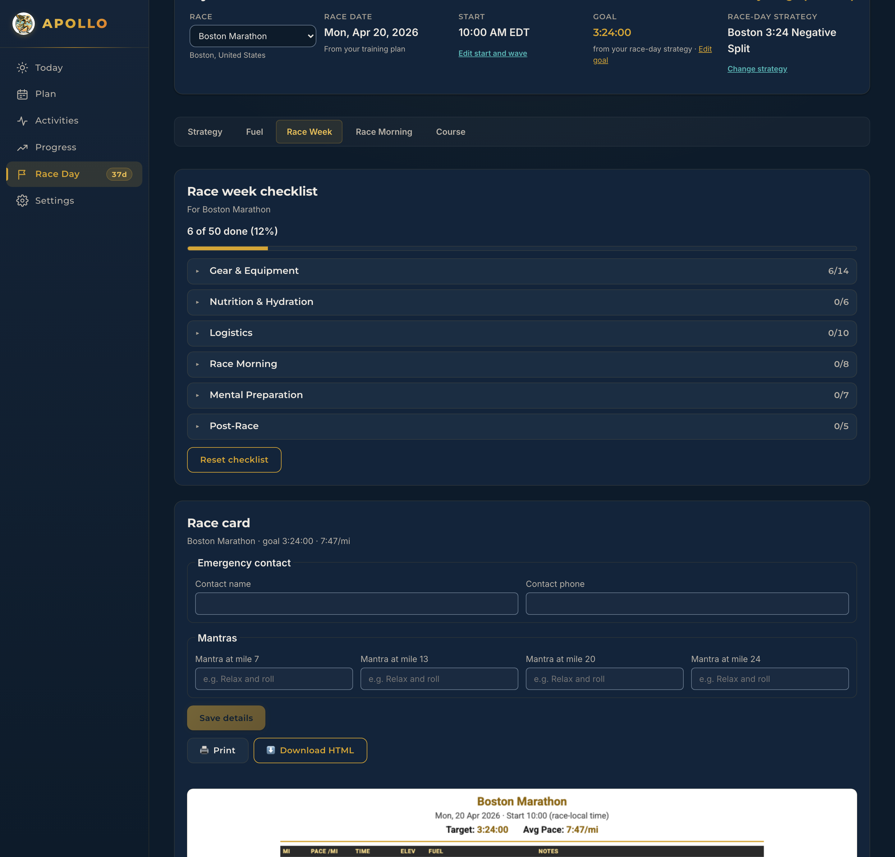

# Structuring & Running a Marathon Training Program with Apollo

A marathon is won — or made joyful — months before race morning. The difference between arriving at the start line durable, rested, and confident versus arriving injured or under-fueled rarely comes down to a single heroic workout. It comes down to **structure**: choosing a weekly load that matches your real starting fitness, running easy days genuinely easy so quality workouts hit their physiological target, adapting calmly when life interrupts the calendar, and rehearsing race-day pacing and nutrition long before taper begins.

This manual explains how to design, calibrate, run, adapt, and finish a complete marathon cycle using **Apollo**.

> **New to Apollo?** Start with the **[Illustrated Quick-Start Guide](QUICK_START_GUIDE.md)** to install the app, connect your watch or activity files, and learn where every screen lives.
>
> **Scope & Safety Note:** Apollo provides evidence-based endurance training guidance, not medical advice. Physiological formulas in Apollo cite peer-reviewed sports science (Daniels, Riegel, Banister, Minetti, Plews, Burke, Jeukendrup, Goldstein). If you experience sharp, localized, or worsening pain, chest discomfort, dizziness, or prolonged systemic fatigue, stop running and consult a qualified clinician. Apollo is an independent open-source project and is not affiliated with or endorsed by any coach, author, or race organization referenced in its plan library.

---

## Table of Contents

- [Part 1: Anatomy of a Marathon Macrocycle](#part-1-anatomy-of-a-marathon-macrocycle)
  - [The Seven Stages of a Complete Season](#the-seven-stages-of-a-complete-season)
  - [Why Cutback Weeks & the 80/20 Balance Work](#why-cutback-weeks--the-8020-balance-work)
  - [Core Coaching Philosophies Compared](#core-coaching-philosophies-compared)
- [Part 2: Selecting, Placing, or Building Your Plan](#part-2-selecting-placing-or-building-your-plan)
  - [Coach Attribution & Fidelity Labels](#coach-attribution--fidelity-labels)
  - [How to Pick the Right Mileage Tier (The Readiness Gate)](#how-to-pick-the-right-mileage-tier-the-readiness-gate)
  - [Complete Reference: All 33 Built-In Plans](#complete-reference-all-33-built-in-plans)
  - [Race-Date-First Placement & Joining Mid-Block Safely](#race-date-first-placement--joining-mid-block-safely)
  - [Building a Custom Plan & Portable Plan Sharing](#building-a-custom-plan--portable-plan-sharing)
- [Part 3: Calibrating Physiology, Paces & Workout Execution](#part-3-calibrating-physiology-paces--workout-execution)
  - [Current Fitness (VDOT) vs. Goal Marathon Time](#current-fitness-vdot-vs-goal-marathon-time)
  - [Calibrating Heart-Rate Zones & Locking Max HR](#calibrating-heart-rate-zones--locking-max-hr)
  - [How to Execute Every Workout Type in Apollo](#how-to-execute-every-workout-type-in-apollo)
  - [Sending Structured Workouts to Your Watch](#sending-structured-workouts-to-your-watch)
- [Part 4: Running the Daily & Weekly Coaching Loop](#part-4-running-the-daily--weekly-coaching-loop)
  - [Step 1 — The Morning Check & Daily Recovery Signal](#step-1--the-morning-check--daily-recovery-signal)
  - [Step 2 — Flexible, Non-Destructive Schedule Adjustments](#step-2--flexible-non-destructive-schedule-adjustments)
  - [Step 3 — Post-Run Splits, Route Effort & Training Journal](#step-3--post-run-splits-route-effort--training-journal)
  - [Step 4 — Managing Your Shoe Rotation & Foam Lifespan](#step-4--managing-your-shoe-rotation--foam-lifespan)
- [Part 5: Navigating Each Phase with Progress Analytics](#part-5-navigating-each-phase-with-progress-analytics)
  - [Reading Banister Fitness (`CTL`), Fatigue (`ATL`) & Form (`TSB`)](#reading-banister-fitness-ctl-fatigue-atl--form-tsb)
  - [Auditing Long-Run Aerobic Durability (`Pa:HR` & Efficiency Factor)](#auditing-long-run-aerobic-durability-pahr--efficiency-factor)
  - [Weekly Race Day Readiness (`0–100`)](#weekly-race-day-readiness-0100)
  - [Using Adaptive Coaching Safely](#using-adaptive-coaching-safely)
- [Part 6: Executing Taper, Fueling & Race Day as a System](#part-6-executing-taper-fueling--race-day-as-a-system)
  - [Mastering the 2–3 Week Taper](#mastering-the-23-week-taper)
  - [Course Selection, Custom GPX Upload & Pacing Models](#course-selection-custom-gpx-upload--pacing-models)
  - [Gut Training, Carb Loading, Sweat Testing & Race Fueling](#gut-training-carb-loading-sweat-testing--race-fueling)
  - [Race Week Checklist, Printable Race Card & Morning Timeline](#race-week-checklist-printable-race-card--morning-timeline)
- [Part 7: Post-Marathon Recovery & Multi-Season Stewardship](#part-7-post-marathon-recovery--multi-season-stewardship)
  - [Running the 4-Week Reverse Taper](#running-the-4-week-reverse-taper)
  - [Bridging Between Seasons or Multiple Marathons](#bridging-between-seasons-or-multiple-marathons)
  - [Long-Term Data Backups & CSV Analysis](#long-term-data-backups--csv-analysis)

---

## Part 1: Anatomy of a Marathon Macrocycle

A marathon block is not eighteen identical weeks of trying to run further and faster. Effective endurance training progresses from **general aerobic capacity** toward **race-specific metabolic durability**, then sheds short-term fatigue just in time for race morning.

### The Seven Stages of a Complete Season

Apollo's phase ribbon on **Plan** and **Today** automatically tracks where you stand across the macrocycle:

| Stage | Typical Window | Primary Physiological Goal | What Focus Looks Like in Apollo |
|---|---|---|---|
| **1. Pre-Block Base** *(Supplemental)* | 8–12 weeks before Week 1 | Capillary density, tendon/bone remodeling, habit consistency | Run `8-Week Aerobic Base Builder` or `12-Week Performance Base (50 mpw)` with mostly Zone 2 mileage and light strides. |
| **2. Base Building** | Weeks 1–3 *(18w plan)* | Establish run-day frequency and aerobic economy | Hit every scheduled run day comfortably; confirm HR zones and shoe rotation. |
| **3. Build Phase** | Weeks 4–11 | Raise lactate threshold and extend glycogen-sparing endurance | Introduce `Tempo` (threshold) workouts, midweek `Medium Long` runs, and 14–18 mi weekend `Long` runs; practice in-run fueling. |
| **4. Peak Training** | Weeks 12–16 | Marathon-specific durability under cumulative load | Highest weekly volume (`CTL` peak), 18–22 mi long runs, `Marathon Pace` fast-finish (`mpFinish`) blocks, full race-kit dress rehearsal. |
| **5. Taper** | Weeks 17–18 *(final 2–3w)* | Shed acute fatigue (`ATL`) while preserving chronic fitness (`CTL`) | Cut mileage ~20–25% then ~40–50%; keep short marathon-pace sharpening touches; finalize **Race Day › Strategy & Fuel**. |
| **6. Race Week & Marathon** | Final 7 days | Glycogen supercompensation, calm logistics, disciplined pacing | Complete **Race Week Checklist**, run 36–48h `8–12 g/kg/day` carb load, follow **Race Morning** timeline and grade-adjusted splits. |
| **7. Reverse Taper** *(Supplemental)* | Weeks +1 to +4 post-race | Repair myofibrillar damage, restore endocrine & HRV balance | Switch to `4-Week Post-Marathon Reverse Taper`; zero speedwork until Resting HR and 7-day HRV stabilize. |

### Why Cutback Weeks & the 80/20 Balance Work

Two structural rules protect marathoners across nearly every plan in Apollo:

1. **Stepback (Cutback) Weeks Every 3–4 Weeks:** Muscle fitness adapts faster than tendons, fascia, and bone. Dropping weekly mileage by **15–25% every third or fourth week** lets connective tissue remodel and allows `ATL` (7-day fatigue) to dip so you absorb the previous three weeks of work instead of carrying hidden micro-trauma into Peak phase.
2. **Polarized / Pyramidal Intensity Discipline (~80/20):** Across recreational and elite marathoners alike (Seiler 2010), roughly **75–85% of weekly running time belongs in Zones 1–2** (conversational aerobic running), with the remaining **15–25% dedicated to purposeful Marathon Pace, Threshold, or VO2max work**. Running easy days in Zone 3 ("gray-zone drifting") adds autonomous nervous system fatigue without creating a strong threshold stimulus — leaving your legs flat when Thursday Tempo or Sunday Marathon-Pace miles arrive.

### Core Coaching Philosophies Compared

Apollo includes plans inspired by the most respected marathon methodologies in distance running. Understanding *how* they build endurance helps you pick one that fits both your physiology and your work/family week:

- **Hal Higdon (Classic Progressive Long Run):** Accessible weekday mileage paired with steady weekend long-run progression up to 20 miles. Ideal for first-timers (`Novice 1/2`, `Novice Supreme`) and runners who thrive on straightforward structure (`Intermediate 1/2`, `Advanced 1/2`, `Personal Best`). The 30-week `Novice Supreme` and `Personal Best` add a 12-week base before the 18-week marathon build.
- **Pete Pfitzinger (High Aerobic Volume + Medium-Long Runs):** Treats total weekly aerobic volume and a midweek `Medium Long` run (11–15 miles) plus Lactate Threshold runs and Marathon-Pace long runs as the primary drivers of marathon performance (`18/55`, `18/70`, `18/85`, `12/55`, `12/70`).
- **Jack Daniels (`2Q` — Two Quality Sessions):** Anchors every week around **two substantial quality workouts** (`Q1` + `Q2`) calibrated precisely to VDOT paces (`E`, `M`, `T`, `I`, `R`), leaving the remaining days completely flexible as easy mileage up to your chosen weekly ceiling (`40`, `55`, `70`, or `85 mpw`).
- **Hansons Marathon Method (Cumulative Fatigue):** Distributes volume evenly across **6 days per week** with a **16-mile longest run**, weekly Strength/Speed intervals, and weekly Marathon-Pace tempos — teaching you to run the *last* 16 miles of the marathon on pre-fatigued legs rather than relying on a single oversized Sunday run.
- **FIRST & Jeff Galloway (Low-Day / Run-Walk Durability):** **FIRST (`Run Less, Run Faster`)** replaces easy junk miles with 3 focused quality runs plus 2 structured cross-training sessions; **Galloway (`Run-Walk-Run`)** uses planned walk breaks from Mile 1 on 3 run days/week to minimize orthopedic strain while completing full marathon distance.
- **Designed by Apollo (Apollo Coaching Lab):** Apollo's own schedules, not taken from any coach's book. A name such as "Norwegian-style" or "Canova-style" describes the training idea the plan borrows; it doesn't mean that coach wrote or endorsed it. The four marathon plans are **Time-on-Feet Endurance (3h Cap)** (long runs stop at 3 hours, for runners expecting a 4:30–6:00 marathon), **Boston Qualifier (BQ) 18/60**, **Norwegian-Style Sub-Threshold** (two controlled sessions a week, a little slower than threshold pace) and **Canova-Style Specific Block 16/75** (hills and general endurance first, then long marathon-pace sessions).

---

## Part 2: Selecting, Placing, or Building Your Plan

Open **Plan → Change plan or race date** (or step through first-run onboarding) to browse, search, and filter Apollo's plan library.

### Coach Attribution & Fidelity Labels

Every built-in plan shows where it comes from. Plans based on a coach's work carry a fidelity label and link to the coach's official book or website:

- **Published schedule** — Follows the coach's free, publicly posted schedule day for day (all eight Hal Higdon plans). Apollo adds pace targets and estimates the distance of timed sessions and repeats.
- **Representative** — Follows the structure, workout types, and peak mileage of a classic program in Apollo's own day-by-day schedule (read the coach's book for the full physiology and alternative schedules).
- **Method** — Original day-by-day schedule authored for Apollo applying that coach's or school's published training principles (such as weekly mileage distribution, workout hierarchy, or time-on-feet caps), without copying copyrighted book tables.
- **Designed by Apollo** — Apollo's own schedule (the Apollo Coaching Lab plans and the four base and recovery blocks). It doesn't follow any coach's book, so it has no book links.

### How to Pick the Right Mileage Tier (The Readiness Gate)

The #1 planning mistake in marathon training is choosing a plan based on **peak mileage you wish you ran** rather than **base mileage you have actually run over the past 6 weeks**. Use these two safety checks before clicking **Start plan**:

1. **Match Week 1–2 to Your Recent 4–6 Week Average:** Week 1 of your chosen plan should sit within **10–15% of your current comfortable weekly mileage**. For example, Pfitzinger `18/55` begins around `33 mi` (`53 km`) in Week 1 — you should already be comfortably running `28–35 mpw` before starting it. If you are currently at `18 mpw`, precede `18/55` with Apollo's `8-Week Aerobic Base Builder` or choose `Intermediate 1` / `Novice 2`.
2. **Respect Run-Day Frequency & AM/PM Doubles:** Moving from 4 run days/week to 6 days/week is a major orthopedic step even at the same mileage. Plans tagged **`AM/PM doubles`** (`12/70`, `18/70`, `18/85`, `Daniels 2Q 70/85`, `Norwegian-Style Sub-Threshold`, `Canova-Style 16/75`) split high-mileage recovery days into two shorter runs on peak days and are intended for experienced high-volume runners.

### Complete Reference: All 33 Built-In Plans

Apollo v1.0.9 ships with **33 built-in schedules**: **29 marathon training plans** plus **4 supplemental base, recovery, and maintenance blocks** *(distances shown in miles; switch Apollo to Kilometres in **Settings › Athlete Profile** to convert every schedule automatically)*. **Peak Weekly Volume** is the biggest training week with race days left out, the same figure the Plan Chooser shows.

#### A. Hal Higdon Marathon Plans (8)

| Plan | Weeks | Peak Weekly Volume | Longest Training Run | Run Days / Wk | Fidelity | Best Suited For |
|---|---:|---:|---:|---:|---|---|
| **Novice 1** | 18 | 40 mi | 20 mi | 4 | Published schedule | First-time marathoners building steadily from a 12–15 mpw base |
| **Novice 2** | 18 | 36 mi | 20 mi | 4 | Published schedule | First-timers or second-timers wanting weekend race-pace practice |
| **Novice Supreme (30-Week)** | 30 | 40 mi | 20 mi | 4 | Published schedule | New runners who can already run 3 miles and have 7 months to build patiently (12-week base with Sunday walks, then Novice 1) |
| **Personal Best (30-Week)** | 30 | 44 mi | 20 mi | 5–6 | Published schedule | Runners with two or more marathons behind them: 12 weeks of hills, short repeats, tempo runs and 5K–10K tune-up races, then an 18-week marathon build |
| **Intermediate 1** | 18 | 44 mi | 20 mi | 4–5 | Published schedule | Stepping up to 5 days/week and back-to-back weekend endurance without track speedwork |
| **Intermediate 2** | 18 | 50 mi | 20 mi | 4–5 | Published schedule | Experienced 30+ mpw runners ready for three 20-mile long runs |
| **Advanced 1** | 18 | 59 mi | 20 mi | 5–6 | Published schedule | Competitive runners adding Thursday hill/tempo work and Tuesday speed |
| **Advanced 2** | 18 | 56 mi | 20 mi | 5–6 | Published schedule | Time-goal runners wanting two structured weekday quality workouts |

#### B. Pete Pfitzinger Marathon Plans (7)

| Plan | Weeks | Peak Weekly Volume | Longest Training Run | Run Days / Wk | Doubles | Fidelity | Best Suited For |
|---|---:|---:|---:|---:|:---:|---|---|
| **18/55** | 18 | 55 mi | 20 mi | 5 | — | Representative | Time-goal runners (`30+ mpw` base) ready for LT runs + MP long runs |
| **12/55 Method** | 12 | 55 mi | 20 mi | 5 | — | Method | Compressed 12-week build for runners already holding a solid 35–40 mpw base |
| **12/70 Method** | 12 | 70 mi | 21 mi | 6 | AM/PM *(4 days)* | Method | Experienced high-mileage runners on a tighter 12-week calendar |
| **18/70 Method (Doubles)** | 18 | 71 mi | 22 mi | 6 | AM/PM | Method | Sub-3:15 / BQ / competitive marathoners comfortable at 45–50+ mpw |
| **18/85 Elite Method (Doubles)** | 18 | 85 mi | 22 mi | 7 | AM/PM | Method | High-volume sub-elite runners (`60+ mpw` base) thriving on aerobic volume |
| **Multiple Marathoning (12-Week)** | 12 | 52 mi | 19 mi | 4–5 | — | Method | Bridging two marathons spaced 12 weeks apart (recovery → rebuild → taper) |
| **Multiple Marathoning (8-Week)** | 8 | 48 mi | 17 mi | 4–5 | — | Method | Bridging two marathons spaced 8 weeks apart with recovery prioritized first |

#### C. Jack Daniels `2Q` Marathon Plans (4)

| Plan | Weeks | Peak Weekly Volume | Longest Training Run | Run Days / Wk | Doubles | Fidelity | Best Suited For |
|---|---:|---:|---:|---:|:---:|---|---|
| **2Q Marathon (Up to 40 mpw)** | 18 | 40 mi | 15 mi | 5 | — | Method | Data-driven runners wanting exact VDOT `T` and `M` sessions on modest volume |
| **2Q Marathon (41–55 mpw)** | 18 | 55 mi | 19 mi | 5 | — | Method | Intermediate/advanced runners preferring 2 big quality workouts + easy fill |
| **2Q Marathon (56–70 mpw)** | 18 | 70 mi | 20 mi | 6 | AM/PM | Method | Seasoned 55+ mpw runners executing long combined `E + M + T` sessions |
| **2Q Marathon (71–85 mpw)** | 18 | 85 mi | 22 mi | 7 | AM/PM | Method | High-mileage competitive marathoners with mature recovery habits |

#### D. Hansons Marathon Method Plans (3)

| Plan | Weeks | Peak Weekly Volume | Longest Training Run | Run Days / Wk | Fidelity | Best Suited For |
|---|---:|---:|---:|---:|---|---|
| **Just Finish** | 18 | 42 mi | 16 mi | 5 | Method | Runners preferring steady 5-day frequency and capped 16-mile long runs |
| **Beginner** | 18 | 58 mi | 16 mi | 6 | Method | First-time Hansons athletes ready for 6 days/week cumulative fatigue + SOS workouts |
| **Advanced** | 18 | 59 mi | 16 mi | 6 | Method | Experienced 6-day runners targeting aggressive negative/even splits via SOS quality |

#### E. Low-Day, Run-Walk & Guided Plans (3)

| Plan | Weeks | Peak Weekly Volume | Longest Training Run | Run Days / Wk | Special Mode | Fidelity | Best Suited For |
|---|---:|---:|---:|---:|:---:|---|---|
| **FIRST — Run Less, Run Faster** | 16 | 34 mi | 20 mi | 3 *(+2 cross)* | Cross-train | Method | Triathletes, injury-prone runners, or busy athletes pairing 3 hard runs with cycling/swimming |
| **Jeff Galloway — Run-Walk-Run (20-Week)** | 20 | 28 mi | 20 mi | 3 | Time / run-walk | Method | Runners using structured run/walk intervals from Mile 1 to protect joints and finish strong |
| **Nike Run Club — Marathon Plan** | 18 | 40 mi | 20 mi | 5 | — | Representative | Approachable 5-day variety mixing recovery, speed, tempo, and progressive long runs |

#### F. Apollo Coaching Lab Marathon Plans (4) — Designed by Apollo

| Plan | Weeks | Peak Weekly Volume | Longest Training Run | Run Days / Wk | Doubles / Mode | Fidelity | Best Suited For |
|---|---:|---:|---:|---:|:---:|---|---|
| **Time-on-Feet Endurance (3h Cap)** | 18 | 31 mi | 16 mi *(≤ 3h)* | 4 | Time-based | Designed by Apollo | Runners expecting a 4:30–6:00 marathon; long runs stop at 3 hours, so no training day approaches marathon length |
| **Boston Qualifier (BQ) 18/60** | 18 | 59 mi | 21 mi | 5–6 | — | Designed by Apollo | Runners chasing a Boston qualifying time: hills, threshold runs, medium-long runs and marathon-pace Saturdays |
| **Norwegian-Style Sub-Threshold** | 18 | 66 mi | 21 mi | 6 | AM/PM *(peak block)* | Designed by Apollo | Experienced runners who prefer two controlled sessions a week (1 km and 2-mile repeats a little slower than threshold) with easy long runs |
| **Canova-Style Specific Block 16/75** | 16 | 74 mi | 22 mi | 7 | AM/PM | Designed by Apollo | Advanced marathoners already base-fit, focusing 16 weeks on long marathon-pace sessions |

#### G. Supplemental Base, Recovery & Maintenance Blocks (4) — Designed by Apollo

Available under **Plan → Change plan or race date → Base & recovery**. These blocks have no race day: you choose the date Week 1 starts, they show no taper or race-week phases, and your own race date on **Race Day** stays in charge:

| Plan | Weeks | Peak Weekly Volume | Longest Run | Run Days / Wk | When to Run It |
|---|---:|---:|---:|---:|---|
| **8-Week Aerobic Base Builder** | 8 | 31 mi | 11 mi | 4–5 | Before a Novice/Intermediate 18-week marathon plan (`15 → 31 mpw`) |
| **12-Week Performance Base (50 mpw)** | 12 | 50 mi | 15 mi | 5 | Before Pfitzinger `18/55`, `18/70`, `BQ 18/60`, or `Daniels 2Q 55` |
| **4-Week Post-Marathon Reverse Taper** | 4 | 29 mi | 10 mi | 3–5 | Immediately starting the Monday after marathon race day |
| **6-Week Off-Season Maintenance** | 6 | 32 mi | 12 mi | 5 | Between training cycles to hold aerobic fitness with low mental pressure |

### Race-Date-First Placement & Joining Mid-Block Safely

When you enter your marathon date, Apollo aligns the schedule **backward from race day** so the final week's marathon lands on your race date (including Saturday or Monday marathons like Boston).

- **More time than the plan length?** Apollo tells you the exact calendar Monday when Week 1 will start. Use a **Supplemental Base** or **Maintenance** block in the meantime so you arrive at Week 1 fresh and ready.
- **Less time than the plan length (Joining Mid-Block)?** Suppose your race is 13 weeks away and you pick an 18-week plan. Apollo automatically previews joining at **Week 6**, inspects your synced/imported running over the last 4 weeks, and checks whether Week 6's mileage or long run is a risky jump from what your legs have been doing — offering a 12-week plan or gentler alternative before you commit.

### Building a Custom Plan & Portable Plan Sharing

If your work shifts, parenting schedule, or club track night demands a bespoke layout, select **Build my own plan** (the **Custom Plan Builder**):

1. Set your **Plan duration** (`12` to `24` weeks), **Run days per week** (`3` to `6`), **Preferred long-run day** (for example, Saturday instead of Sunday), **Starting weekly mileage**, and **Peak weekly mileage**.
2. Apollo automatically constructs progressive 3-week build waves, 4th-week recovery stepbacks, midweek quality distribution, and a structured 2–3 week taper.
3. From **Plan › Export plan**, you can export any active or custom plan as:
   - **`.ics` Calendar File** — Adds every day's workout with VDOT-calibrated target paces to Apple Calendar, Google Calendar, or Outlook.
   - **Portable Plan JSON (`.apollo-plan.json` / `apollo.training-plan.v1`)** — Share your custom block with a training partner or coach, or archive a winning build for next season. The file holds the plan itself (not your moves, skips or race-date placement). When someone imports it, Apollo checks it, saves it as a new plan and marks it *Imported plan*, because Apollo can't verify a file's schedule or its listed author.

---

## Part 3: Calibrating Physiology, Paces & Workout Execution

A training plan tells you *how far* and *what type* of workout to run; **Settings › Athlete Profile** tells Apollo *how fast* and *at what heart rate* you should run each session.

### Current Fitness (VDOT) vs. Goal Marathon Time

In **Settings › Athlete Profile**, Apollo intentionally separates **Recent race** from **Goal marathon time**:

- **Recent race (`5K`, `10K`, `Half marathon`, `Marathon`, or custom distance):** Powers Jack Daniels' **VDOT** calculation and blends it with Peter Riegel's endurance formula (`T2 = T1 × (D2 / D1)^1.06`) to set your **current physiological training paces** (Easy, Threshold, Interval, Repetition) and your live **Race Prediction** on **Progress › Overview**.
- **Goal marathon time (`H:MM:SS`):** Sets your aspirational **Race-Day Strategy** default and anchors goal-pace rehearsals when you don't have a recent race on file.

> **Coaching rule of thumb:** Always run **Easy**, **Threshold (Tempo)**, and **Interval (Speed)** workouts off your *current* fitness (Recent Race VDOT), not a stretch goal time you hope to hit four months from now. Running threshold intervals 15 sec/mi faster than your actual lactate turnpoint turns a controlled aerobic threshold session into an anaerobic survival test and stalls adaptation. As your fitness rises mid-block (confirmed by a tune-up 10K or Half Marathon!), update **Recent race** in **Settings › Athlete Profile** and let your paces ratchet up naturally.

### Calibrating Heart-Rate Zones & Locking Max HR

Apollo uses a clean 5-zone percentage-of-Max-HR model across **Today**, **Activities**, and **Progress › Heart Rate**:

| Zone | % of Max HR | Daniels Equivalent | Primary Purpose & Breathing Feel |
|---|---|---|---:|
| **Z1 · Recovery** | `50–60%` | Low `E` | Active blood flow, recovery shakeouts, warm-up/cool-down; effortless nasal/full-sentence breathing |
| **Z2 · Aerobic** | `60–70%` | `E` (Easy / Long) | Mitochondrial biogenesis, fat oxidation, capillary growth; comfortable full-sentence conversation |
| **Z3 · Tempo** | `70–80%` | `M` (Marathon Pace) | Aerobic power & glycogen economy at race rhythm; steady 4–6 word phrases |
| **Z4 · Threshold** | `80–90%` | `T` (Threshold) | Raises lactate clearance ceiling; "comfortably hard" sustainable for ~45–60 min all-out |
| **Z5 · VO2 Max** | `90–100%` | `I` / `R` (Intervals) | Maximal cardiac stroke volume & neuromuscular speed; 1–2 word cues only |

**How Apollo keeps your Max HR honest:**
- By default, if a synced run records a genuine peak heart rate higher than your stored profile (and passes sanity bounds), Apollo updates your Max HR automatically. Also, if `intervals.icu` wellness/sport-settings sync is enabled, Apollo can populate Resting HR (14-day median) and Max HR / LTHR when you haven't set one manually.
- **Watch out for optical wrist-HR cadence lock:** Cold, dry mornings can occasionally cause wrist optical sensors to lock onto footstrike cadence (~175–185 spm) and report a false 195+ bpm spike. If you know your true Max HR from a field test, hill sprint finish, or chest strap, type it into **Settings › Athlete Profile › Max heart rate (bpm)** and click **Save**. Manual entries mark your profile as **`Set by you`**, locking it against accidental auto-inflation from noisy sensor spikes.
- **Measured vs. Estimated Zone Time:** On **Progress › Heart Rate**, Apollo explicitly tells you when 30-day zone distribution is *estimated* from whole-run average HR versus *measured* from second-by-second HR streams — so you are never misled by summary approximations.

### How to Execute Every Workout Type in Apollo

| Apollo Workout Type | Target Pace / Zone | Execution Playbook |
|---|---|---|
| **Recovery** *(incl. AM/PM Doubles)* | Slowest end of Easy · `Z1–low Z2` | Leave ego at the door. Finish feeling fresher than when you started. On **AM/PM double** days, separate the two runs by **6–8+ hours** and keep the secondary shakeout to 30–45 minutes completely relaxed. |
| **Easy** | Daniels `E` · `Z2` | Your bread-and-butter mileage. Pace is a *range*, not a single number — slow down 15–30 sec/mi on hilly routes, humid mornings, or the day after a hard session. |
| **Medium Long** | Easy to steady aerobic · `Z2` (drifting gently to low `Z3` late) | Midweek 10–15 mile endurance builder in Pfitzinger and BQ plans. Start easy for 2–3 miles, settle into a smooth unhurried rhythm, and practice taking 1–2 gels on runs over 80 minutes. |
| **Long** | `E` pace (`Z2`), or `mpFinish` (`last X mi @ MP`) | Standard long runs stay **45–90 sec/mi slower than Marathon Pace** (`Z2`) to maximize time-on-feet without excessive recovery cost. When the description specifies a **fast finish** (e.g., `18 mi w/ 10 mi @ MP`), run the opening miles genuinely easy, then lock smoothly into Marathon Pace for the closing segment — simulating miles 16–26 on tired legs. |
| **Marathon Pace (`MP`)** | Goal / VDOT `M` · `Z3` | Rehearse race shoes, singlet/shorts, hydration vest or belt, and exact race-day gel cadence (`every 20–25 min`). Focus on relaxed shoulders and economical cadence. |
| **Tempo** | Daniels `T` · `Z4` (`~83–88% Max HR` after 10 min) | Always open with `1.5–2 mi` (`15 min`) easy warm-up + 4 strides, run the continuous tempo or cruise intervals (`e.g. 4 × 1 mi w/ 1 min jog`, as in Daniels' 2Q plans) at a controlled "comfortably hard" effort, and cool down `1–2 mi` easy. Heart rate lags pace for the first 5–8 minutes — pace smoothly from the start rather than sprinting to force HR into Z4 immediately! |
| **Speed** | Daniels `I` (`3K–5K` effort, `Z5`) or `R` (fast relaxed economy) | Warm up thoroughly (`15–20 min` + drills/strides). Hit target split from Rep 1 without straining your jaw or hands; jog recoveries slowly so you can complete the final repeat at the exact same split as the first. |
| **Cross-Training** | Low-impact aerobic (`Z1–Z2`, `30–75 min`) | Cycling, pool running, swimming, rowing, or elliptical. Synced rides and swims automatically satisfy scheduled Cross-Training days and can be toggled on/off in your **Fitness & Form** load chart (`Include cross-training`). |

### Sending Structured Workouts to Your Watch

Instead of writing splits on your hand, Apollo can push your VDOT-calibrated workouts directly onto your wrist for free via **[intervals.icu](https://intervals.icu)**:

1. Connect `intervals.icu` in **Settings › Connections**.
2. In `intervals.icu` on the web, open **Settings → Run** and confirm a **Threshold Pace** is saved (Garmin watches require this to display pace targets instead of *"No Target"*). Turn on workout upload to your Garmin, COROS, Suunto, Polar, or Wahoo account inside `intervals.icu`.
3. In Apollo, open **Plan → Export plan** and sync your plan to the `intervals.icu` calendar. Whenever you update your VDOT paces or edit a day on Apollo's **Plan** page, Apollo updates the calendar cleanly without creating duplicates.

---

## Part 4: Running the Daily & Weekly Coaching Loop

Consistency over 18 weeks never looks like 100% perfection — in fact, **85–95% adherence with smart adjustments** almost always beats stubbornly forcing 100% adherence through illness or early injury signals. Here is how to run Apollo day by day.

### Step 1 — The Morning Check & Daily Recovery Signal

Open **Today** each morning. Alongside **Today's Workout**, inspect your **Form (`TSB`)** badge and, if you have enabled wellness sync (`Settings › Sync › Also sync sleep, HRV and resting HR`), your **Recovery** card.

Apollo's recovery engine (`computeRecoverySnapshot`) is **conservative by design** so one restless night or noisy optical reading never panics you:

- **HRV (`ln rMSSD`):** Compares your **7-day rolling average** (requiring ≥ 3 readings) against your **60-day personal normal band (`mean ± 0.5 SD`)** following Plews et al. (2013, 2014). A single low morning reading is displayed for context, *not* treated as an alarm; a 7-day rolling average below your normal band counts as 1 warning signal (`> 1.0 SD` below = **strong signal**).
- **Resting Heart Rate:** Compares your newest reading against your prior **30-day average**; `≥ +5 bpm` = 1 signal; `≥ +10 bpm` = **strong signal**.
- **Sleep:** Compares last night against a `7h` floor and your 7-night average; `< 6h` (or `< 7h` and `≥ 1h` below usual) = 1 signal; `< 5h` = **strong signal**.
- **Subjective Feel (`intervals.icu`):** High or extreme self-reported fatigue, soreness, or stress (`3` or `4`) = 1 signal.

**How to act on the status:**
- **Recovered (`Well recovered — Train as planned`):** Execute quality workouts, Marathon Pace segments, and long runs with confidence.
- **OK (1 mild signal):** Run easy workouts gently at the bottom of Zone 2; on quality days, extend your warm-up and assess how your legs feel after 15 minutes before locking into Tempo/MP pace.
- **Caution (2+ signals or 1 strong signal):** Use the **`…` menu** on **Today** or **Plan** to swap today's Tempo/Speed workout with tomorrow's Easy/Rest day, or convert today to an **Easy** shakeout. Protecting one shaky day prevents losing two weeks.

### Step 2 — Flexible, Non-Destructive Schedule Adjustments

Every edit you make on **Plan** (or **Today**) lives in a **non-destructive Plan Overlay** on top of the original schedule — meaning you can click **Restore original** on any day at any time. Use these four rules whenever real life reshapes your week:

1. **Missed 1–2 days (work travel, mild cold, family event)?** Click **Skip** on the missed day and **move on**. Never "make up" missed weekday miles by tacking 4 extra miles onto Sunday's 18-miler.
2. **Shifting workouts inside a week?** Keep **at least one Easy or Rest day** between any two quality pillars (`Tempo`, `Speed`, `Marathon Pace`, or `Long`). Never stack a Thursday Threshold workout on Saturday right before a Sunday 20-mile Long Run.
3. **Missed 4–7 days (illness or minor strain)?** Resume with **2–3 days of strictly Easy Zone 2 running** before touching quality pace. Use **Convert to easy** on your first scheduled quality session back.
4. **Missed 10+ days?** Re-evaluate your peak mileage target objectively. Use **Adaptive Coaching** or switch down one volume tier (for example, `18/70` → `18/55`, or `Intermediate 2` → `Intermediate 1`) via **Change plan or race date** so your tendons aren't shocked back into peak load.

### Step 3 — Post-Run Splits, Route Effort & Training Journal

When your run syncs from Garmin Connect, `intervals.icu`, Strava, or a dropped `.fit`/`.gpx` file, Apollo automatically matches it within a **±2-day window** to the appropriate planned session and grades the execution:

- **Split Pacing & Consistency:** Expand the run on **Activities** to review per-mile/km pace bars and split-consistency grading. Aim for controlled, progressive splits on Easy and Long runs (first two miles slowest as tendons warm up) and tight ±3–5 sec/mi consistency on Tempo and Marathon-Pace segments.
- **Route Effort Recognition (`Gold` / `Silver` / `Bronze`):** Running the same neighborhood 6-mile loop or park river path every Tuesday? Apollo fingerprints repeated GPS routes offline and compares your pace-to-heart-rate efficiency across attempts — rewarding genuine aerobic economy gains without turning easy days into races.
- **Training Journal & RPE:** Take 20 seconds after key long runs and tempos to log **RPE (`1–10`)**, feel tags, and a short note on what gels/fluids you took and how your stomach felt at Mile 14+. Four weeks before race day, this journal becomes gold when locking in **Race Day › Fuel**.

### Step 4 — Managing Your Shoe Rotation & Foam Lifespan

Midsole compression degrades impact attenuation gradually long before an outsole looks bald. Open **Activities → Manage shoes** to build a purposeful marathon shoe rotation:

1. **Rotate at least two pairs if mileage exceeds 30 mpw (`50 km/wk`):** Research (Malisoux et al. 2015) links multi-shoe rotation to ~39% lower running-injury risk because varying stack geometry and drop distributes load slightly differently across the Achilles, plantar fascia, and knee.
   - *Pair 1 (`Daily Trainer` / `Recovery`):* Durable workhorse for weekday Easy and Recovery runs (`Default` shoe).
   - *Pair 2 (`Long Run` / `Tempo / Speed`):* Lighter or super-trainer foam for midweek Tempos and weekend Long runs.
   - *Pair 3 (`Race / Carbon`, optional):* Your marathon race shoe.
2. **Test your exact marathon pair on at least one 14–18 mi run with Marathon-Pace miles** during Peak phase to verify toe-box room (feet swell over 3+ hours!), heel lockdown, and calf/Achilles load.
3. **Watch Apollo's pre-race retirement projection:** Each shoe tracks miles against its retirement limit (default `400 mi` / `650 km`; adjust lower to `200–300 mi` for pure PEBA race-day supershoes). Apollo projects your weekly mileage forward to race day and alerts you early if a pair is on track to pass its limit before the marathon — giving you time to break in a fresh pair 3–4 weeks out, never during race week!

---

## Part 5: Navigating Each Phase with Progress Analytics

Once you have 3–4 weeks of runs logged, Apollo's **Progress** page gives you objective physiological feedback so you know whether your training load is absorbing cleanly.

### Reading Banister Fitness (`CTL`), Fatigue (`ATL`) & Form (`TSB`)

Open **Progress › Fitness & Form** to view Apollo's Performance Management Chart (Banister impulse-response model):

- **Fitness (`CTL`, 42-day rolling load — teal curve):** Rises steadily across Base, Build, and Peak as consistent weekly volume banks aerobic durability. Aim for a smooth staircase (`+3 to +6 CTL points/week` during build waves), not jagged vertical spikes.
- **Fatigue (`ATL`, 7-day rolling load — gold curve):** Reacts quickly to big long runs and stepback weeks. During Peak weeks, `ATL` sits comfortably *above* `CTL`.
- **Form (`TSB = CTL − ATL` — colored vertical bars):** Tells you how fresh or loaded your body is right now:

| Apollo Form (`TSB`) Zone | Range | Coaching Interpretation |
|---|---|---|
| **Overreaching** | `Below −20` | High acute load relative to 6-week base. Touching `−21 to −28` briefly on Sunday evening after a peak 20-miler is normal *if* Monday/Tuesday rest pulls you back up; lingering below `−20` for >7–10 days spikes injury and illness risk. *(Apollo flags overreaching below `−20`, intentionally stricter than `intervals.icu`'s `−30` band.)* |
| **Productive Training** | `−20 to 0` | The engine room of Build and Peak training — enough stimulus to drive adaptation while recovering between key workouts. |
| **Fresh** | `0 to +15` | Ideal for 4th-week cutbacks, tune-up 10K / Half Marathon races, and early Taper. |
| **Peak Race Readiness (`Race window`)** | **`+15 to +25`** | **Target marathon-morning zone.** Fatigue has cleared while 90%+ of peak `CTL` remains intact. Follow Apollo's dashed forward projection line into race day! |
| **Transition / Very fresh** | `Above +25` (`> +30`) | Appropriate post-marathon or off-season; holding `> +25` *before* race day can leave legs feeling slightly flat/detrained unless sharpened with brief strides. |

### Auditing Long-Run Aerobic Durability (`Pa:HR` & Efficiency Factor)

Hitting 20 miles on paper does not guarantee marathon readiness if your heart rate climbs from `142 bpm` at Mile 4 to `174 bpm` at Mile 18 at the exact same pace. Open **Progress › Heart Rate** and scroll to **Aerobic Durability (`Pa:HR & Efficiency Factor`)**:

**How Apollo calculates durability:**
1. **Efficiency Factor (`EF`, in `m/min/bpm`):** Divides your grade-adjusted horizontal speed (using Minetti et al. 2002 metabolic cost of uphill/downhill gradients when split elevation is available; grades are clamped to `±30%` and the cost to at most `2.8×` flat running) by your average heart rate. **Higher `EF` = more ground covered per heartbeat.** Watching your steady-run `EF` trend upward over 8–12 weeks (`EF Trend`) is one of the purest indicators of improving marathon fitness.
2. **Aerobic Decoupling (`Pa:HR %`):** Splits continuous steady runs into two halves of equal **moving time**, as Joe Friel and TrainingPeaks do (a run needs heart rate, at least 4 splits and `30 min` of steady running; the history table uses runs of `≥ 40 min` and the headline **Long-Run Pa:HR** metric runs of `≥ 60 min`; interval workouts with split-speed `CV > 12%` are excluded, and a short final split under `50%` of the typical split distance is trimmed):
   $$\text{Pa:HR (\%)} = \frac{\text{EF}_{\text{first half}} - \text{EF}_{\text{second half}}}{\text{EF}_{\text{first half}}} \times 100$$

**How to act on your `Pa:HR` numbers (Friel / Maunder durability benchmark):**
- **`≤ 3.5%` (`Excellent`) to `≤ 5.0%` (`Coupled`):** Your cardiovascular drift is minimal — your aerobic base supports the distance and pace you are running. Once your 18–20 mile long runs and Marathon-Pace runs hold `Pa:HR ≤ 5%`, you have genuine 26.2 durability.
- **`5.0% – 8.0%` (`Moderate` drift):** Normal early in Base/Build or on warm days. Keep building easy Zone 2 volume, carry fluids/electrolytes earlier in the run, and verify you aren't starting the first 5 miles too fast.
- **`> 8.0%` (`High` drift):** Red flag for pacing or hydration. Either the run started faster than your current aerobic threshold, ambient heat/dehydration reduced stroke volume, or glycogen ran low late in the run. Slow your next long run by `15–20 sec/mi` and fuel at `45–60 g/h` from minute 25 onward.

### Weekly Race Day Readiness (`0–100`)

Every week (on the day you choose in **Settings › Coaching**), Apollo computes a **0–100 Weekly Readiness Score** (`A+` at `95+`, `A` at `88+`, `B+` at `82+`, `B` at `75+`, `C+` at `68+`, `C` at `60+`, `D` below `60`) across five weighted pillars:

1. **Volume (`25%`)** — Actual vs. planned mileage across due days so far.
2. **Consistency (`25%`)** — Share of scheduled workouts completed on due days.
3. **Long Run (`20%`)** — Completion of the week's cornerstone endurance run *(smartly left unpenalized and re-weighted while this week's long run is still ahead on Saturday/Sunday!)*.
4. **Intensity Discipline (`15%`)** — Whether easy days stayed genuinely easy in HR Zones 1–2 and quality workouts hit their intended band.
5. **Recovery Balance (`15%`)** — Respecting planned rest days rather than running through every rest slot.

Aim for consistent **`B+` to `A+` (`82–100`)** weeks across Build and Peak — you do not need `100/100` every week to run a massive personal best.

### Using Adaptive Coaching Safely

On **Progress › Overview** (configured in **Settings › Coaching** under *Conservative*, *Balanced*, or *Aggressive*), Apollo's **Adaptive Coaching** engine watches for sustained overreaching, missed schedule blocks, rapid VDOT breakthroughs, and upcoming taper transitions:

- **Safety rails built into code:** Apollo caps any single automated volume increase at **+10%** (with recovery reductions scaled by **15–30%**) and enforces **Taper protection** (it protects race week and the final 3 weeks before it from any mileage increases).
- **One-click Apply & Undo:** Every applied recommendation writes to the reversible adaptive overlay — if you apply an adjustment and change your mind, click **Undo** to restore the previous schedule cleanly.

---

## Part 6: Executing Taper, Fueling & Race Day as a System

Great marathons happen when training fitness meets calm, practiced execution. Four weeks before race day, open **Race Day** to lock in your race-day plan.

### Mastering the 2–3 Week Taper

During the final 14–21 days:
- **Cut volume, keep gentle rhythm:** Let weekly mileage drop according to your plan (`~75%` at 3 weeks out → `~55%` at 2 weeks out → light shakeouts during Race Week), while keeping short 1–3 mile touches of Marathon Pace so neuromuscular tension stays crisp.
- **Expect "taper phantom aches":** As tissue repair accelerates and glycogen + water fill muscle fibers, temporary tightness or sluggishness on short runs is completely normal. Resist the urge to run an unplanned fast 10K "just to test fitness" — trust the banked `CTL` curve on **Progress › Fitness & Form**.
- **Guard sleep 2–3 nights out:** Pre-race excitement often shortens sleep the night right before the marathon; banking full 8-hour nights on **Thursday and Friday** before a Sunday race ensures full cognitive and physical readiness.

### Course Selection, Custom GPX Upload & Pacing Models

Open **Race Day › Strategy**:

1. **Select a Built-In World Marathon Major or Import Any Course `.gpx`:**
   - **6 World Marathon Majors built in:** **Tokyo**, **Boston**, **London**, **Berlin**, **Chicago**, and **New York City** come pre-loaded with mile-by-mile elevation profiles, landmark segments, aid-station notes, and course-specific training tips.
   - **Running a local, regional, or international marathon?** Click **Import a race** (or create a custom marathon and upload the race organizer's official **`.gpx` course file**). Apollo parses the GPS track and elevation profile locally to generate mile-by-mile / km-by-km climbs, descents, and grade-adjusted splits. Elevation is smoothed over about `150 m` with a `2 m` threshold, so GPS noise doesn't read as hills, and the splits add up to the course totals. If the file measures within `3%` of the race distance, Apollo fits it to finish exactly at that distance (the official `42.195 km` for a marathon); otherwise it keeps the measured length and tells you. Track pieces more than `200 m` apart aren't joined.
2. **Choose the Right Pacing Model for Your Course:**
   - **Negative split (`1–2%` faster second half):** The gold standard for experienced runners on flat-to-gently-rolling courses (Berlin, Chicago, London). Protects glycogen through Halfway (`13.1 mi` / `21.1 km`) and lets you pass hundreds of fading runners from Mile 20 to 26.2.
   - **Even split:** Equal first-half and second-half targets with small grade adjustments on hills. Simple, honest, and ideal when running with a pace group.
   - **Effort-based:** Maintains **constant metabolic effort** rather than constant clock pace — slowing deliberately on steep climbs (like NYC's Queensboro Bridge & Fifth Avenue, or Boston's Newton Hills at Miles 16–21) and taking controlled free speed on gentle descents without hammering your quads early (essential on Boston's net-downhill Miles 1–6!).
   - **Positive split:** Included so first-timers can model a realistic modest second-half fade if desired — though remember that banking `15–20 sec/mi` faster than fitness in Miles 1–10 almost always costs `60–120 sec/mi` in cramps and glycogen depletion after Mile 20.

### Gut Training, Carb Loading, Sweat Testing & Race Fueling

Glycogen depletion ("hitting the wall" around Miles 18–22) and GI distress are both preventable when you treat nutrition like a trainable system on **Race Day › Fuel**:

1. **Train Your Gut in Weeks 6–15 (`20–90 g/h`, Jeukendrup 2014):**
   - Intestinal carbohydrate transporters (`SGLT1` for glucose/maltodextrin, `GLUT5` for fructose) upregulate when practiced weekly on long runs.
   - **Target `30–60 g/h`** for most marathoners using standard glucose/maltodextrin gels or sports drink.
   - **Target `60–90 g/h`** for faster/high-output marathoners **only if using dual-source `glucose + fructose` products** and rehearsed repeatedly on 2+ hour Peak long runs. Apollo automatically flags targets above `60 g/h` with a dual-sugar reminder.
   - Apollo schedules a **`25 g` pre-race gel `15 minutes before start`** with sips of water, spaces in-race gels evenly to match your target `g/h` (aligning cues with nearby course aid stations!), and **stops scheduling gels in the final `15 minutes`** because late carbs cannot clear the gut in time to reach working muscle.
2. **Execute the 36–48h Carbohydrate Load (Burke et al. 2011):**
   - Starting **2 days before the race**, shift to **`8–12 g/kg/day`** of familiar, low-fiber, low-fat carbohydrates (white rice, pasta, bagels, pretzels, ripe bananas, juice/carb drink mix — Apollo caps reference mass at `100 kg` for safety). You don't need to stuff yourself at a giant Saturday-night dinner; spreading smaller carb-rich meals and drinks evenly across 36–48 hours leaves your stomach light on race morning. Expect `1–2 kg` (`2–4 lb`) of scale weight gain — every gram of stored muscle glycogen binds ~3 grams of water that your body releases for cooling during the race!
3. **Race-Morning Breakfast (`~2 g/kg`, 3 hours pre-start):**
   - Eat familiar simple carbs (`1–4 g/kg` window; Apollo targets `~2 g/kg`) **3 hours before your wave gun** (e.g., bagel with honey/jam + banana + sports drink), leaving time for full digestion before corral entry.
4. **Calibrate Fluids & Sodium with the Sweat-Rate Test:**
   - During a 45–90 minute steady run in race-like temperatures 3–5 weeks out, weigh yourself nude/dry before and after (` Race Day › Fuel › Sweat test `), noting any fluid consumed.
   - Apollo calculates your hourly sweat rate and builds a hydration target **capped at a safe `800 mL/h` planned ceiling** (roughly maximal gastric emptying while running, guarding against sloshing and over-drinking / hyponatremia). Check **Salty sweater** if your hat/singlet dries with white salt crystals to receive elevated sodium replacement guidance.
5. **Optional Pre-Race Caffeine (`~3 mg/kg`, Goldstein et al. 2010):**
   - If you tolerate caffeine well and tested it on long runs, enable caffeine in **Settings › Athlete Profile** to display your `~3 mg/kg` pre-race timing card (`45–60 min` before the gun).

### Race Week Checklist, Printable Race Card & Morning Timeline

- **Race Week Checklist (`Race Day › Race Week`):** Check off 50 curated items across **Gear & Equipment**, **Nutrition & Hydration**, **Logistics**, **Race Morning**, **Mental Preparation**, and **Post-Race** (plus course-specific items for your selected Major, and custom items of your own).
- **Printable Race Card (`Race Day › Race Week`):** Enter your emergency contact and four **Mile-Marker Mantras** (`Mile 7` patience cue, `Mile 13` rhythm check, `Mile 20` composure cue, `Mile 24` closing grit) and print or save a clean one-page companion containing your 5K timing-mat splits, segment notes, fuel schedule, and pace band.
- **Race Morning Timeline (`Race Day › Race Morning`):** Enter your wave start time, travel buffer, and bag-check deadline — Apollo counts backward automatically to set your exact wake-up alarm, breakfast window, bathroom/sunscreen/anti-chafe prep, transit departure, gear check, dynamic warm-up, pre-race gel (`T−15 min`), and corral entry.
- **Course Prep (`Race Day › Course`):** Review course-specific terrain notes during Build and Peak phases so your long runs mirror the hills, bridges, or flat cadence demands of your target marathon.

---

## Part 7: Post-Marathon Recovery & Multi-Season Stewardship

Crossing the finish line completes the race, not the physiological cycle. How you treat the four weeks *after* 26.2 determines how healthy and strong you will be in your next training season.

### Running the 4-Week Reverse Taper

Even if quad soreness fades by Thursday after a Sunday marathon, biopsy and biomarker studies show myofibrillar repair, tendon remodeling, and autonomic recovery take **21 to 28 days**.

1. On the Monday after your marathon, open **Plan → Change plan or race date → Base & Recovery** and start Apollo's **`4-Week Post-Marathon Reverse Taper`**:
   - **Days 1–4 post-race:** Complete rest from running; gentle walking, mobility, sleep, protein, and hydration.
   - **Week 1:** Short, zero-pressure 20–35 minute Zone 1 shakeouts only if completely pain-free.
   - **Weeks 2–4:** Gradual return of easy aerobic frequency (`3–5 days/wk`, peaking gently at `29 mi` with a `10 mi` easy Sunday run) and **zero threshold or track intervals**.
2. Watch **Today › Recovery** during Weeks 1–3: wait until both your **Resting HR** and **7-day rolling HRV** settle back inside your normal 60-day range before scheduling hard workouts again.

### Bridging Between Seasons or Multiple Marathons

Once your 4-week reverse taper finishes, choose the bridge that matches your calendar:

- **No race on the immediate horizon?** Run **`6-Week Off-Season Maintenance`** (`~32 mpw` easy + light rhythm) to preserve your hard-earned `CTL` base without schedule pressure.
- **16–26 weeks until your next goal marathon?** Pair **`8-Week Aerobic Base Builder`** or **`12-Week Performance Base (50 mpw)`** directly into your next 16- or 18-week marathon plan — starting the next cycle at a higher aerobic floor than your last one!
- **Running a second marathon 8 or 12 weeks after your first?** Select Pete Pfitzinger's **`Multiple Marathoning (12-Week)`** or **`Multiple Marathoning (8-Week)`** — purpose-built schedules that bake reverse-taper recovery right into the opening weeks before rebuilding concisely into a second race-day peak.

### Long-Term Data Backups & CSV Analysis

Because Apollo stores your entire career locally with zero cloud lock-in, spending two minutes in **Settings › Data & Privacy** ensures years of training logs stay indestructible:

1. **Keep Automatic SHA-256 Backups On:** Apollo automatically writes and verifies checksummed on-device snapshots (`Every 24 hours` by default) and sets aside any unreadable storage key safely in quarantine rather than overwriting it.
2. **Desktop App — Link a Synced Backup Folder:** Under **Settings › Data & Privacy › Backup folder**, click **Choose folder…** and point Apollo to a folder inside **iCloud Drive, Dropbox, OneDrive, Syncthing**, or an external SSD. Apollo automatically mirrors rolling compressed `.json.gz` snapshots there, protecting your training log even if your computer is ever lost or replaced.
3. **Export Clean Spreadsheets Anytime (`Export as CSV`):** Click **Activities**, **Splits**, **Wellness**, or **Training journal** to download standard UTF-8 `.csv` files (activity and split files carry both metric and imperial columns; every text cell is quoted and protected against spreadsheet formulas) for custom post-season analysis, coach review, or permanent personal archiving.
